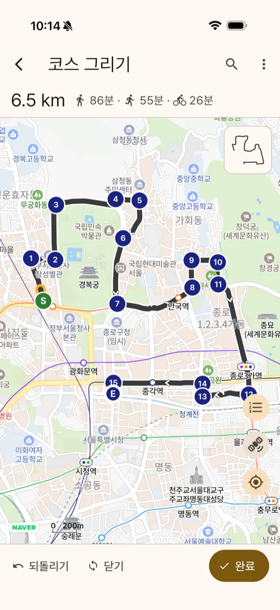

# Phase 4: 홈페이지 서비스 소개 정정 (Landing Content Fix) - Pattern Map

**Mapped:** 2026-11-16
**Files analyzed:** 14 (새 파일 6개 묶음 1 + 고칠 파일 13)
**Analogs found:** 13 / 14 (이미지 파일은 저장소에 선례 없음)

모든 analog는 git 추적 파일입니다 (`git ls-files`로 `index.html`, `scripts/check-site.sh`, `_includes/css/legal.css` 확인). 행 번호는 HEAD `90d8046` 기준입니다.

## File Classification

| 새/고칠 파일 | 역할 | 데이터 흐름 | 가장 가까운 analog | 일치 정도 | 커밋 (D-22) |
|---|---|---|---|---|---|
| `index.html` 13·18행 (메타·OG) | page head (meta) | static content | 같은 줄 자체 (값만 교체) | exact | 문구 커밋 |
| `index.html` 234·245행 (3단계 글·캡션) | page content | static content | 같은 줄 자체 | exact | 문구 커밋 |
| `index.html` 241~243·260·262행 (`t-empty` → 컬러) | page content (SVG badge) | static content | 237~240·257~259·261행 컬러 뱃지 | exact | 빈 뱃지 커밋 |
| `index.html` 51행 `.rp-badge.t-empty` 규칙 | style (「랜딩 전용」) | — | 46~50행 색 규칙 | exact | 빈 뱃지 커밋 (지울지 Open Q1) |
| `index.html` 새 구간 마크업 (`#demo`~`#get` 사이, 약 397행 뒤) | page section | static + browser scroll-snap | `#demo` 362행 section, 히어로 딱지 162행, `.rp-phone` 264행 인라인 값 | role-match | 스크린샷 커밋 |
| `index.html` 「랜딩 전용」 새 CSS + `@media (max-width: 860px)` 추가 + 93행 주석 | style | — | 93~94행 `.rp-get`, 100~115행 미디어 블록, `legal.css:35` figure 스크롤 | role-match | 스크린샷 커밋 |
| `images/app/screen-{draw,run,badge}-{564,846}.webp` (새) | static asset | file-I/O (빌드 시 복사) | 없음 (`favicon/*.png`가 유일한 이진 자산) | no analog | 스크린샷 커밋 |
| `scripts/check-site.sh` 6번 항목 (선택) | build check | batch | 같은 파일 5번 항목 86~89행 | exact | 별도 build 커밋 (문서 푸시와 함께) |
| `CLAUDE.md` + `.claude/CLAUDE.md` 방침 표 행 (D-23) | doc | — | 같은 표 「Jekyll 빌드 전환」 행 (「Phase 3까지 적용됨」) | exact | 문서 커밋 (라이브 확인 뒤) |
| `CLAUDE.md` Pages·Architecture·푸터·Assets 문단 (D-24) | doc | — | 112행 SVG 문단, Assets 절 `favicon/` 항목 | role-match | 스크린샷 뒤 문서 커밋 |
| `.planning/codebase/{CONVENTIONS,ARCHITECTURE,STRUCTURE,STACK}.md` (+`TESTING.md` 6번 항목 시) | doc (원본 맵) | — | `CONVENTIONS.md:175`, `ARCHITECTURE.md:47`, `STRUCTURE.md:124` | exact | 문서 커밋 → `generate-claude-md` |
| `.planning/ROADMAP.md` 167·172행, `.planning/REQUIREMENTS.md` 34행 (D-08) | doc (기준 문장) | — | 같은 줄 | exact | 첫 문서 커밋 |
| `.planning/baseline/USER-TASKS.md` 작업 10 (291~313행, D-19) | doc (사용자 절차서) | — | 같은 절 자체 | exact | 첫 문서 커밋 |

## Pattern Assignments

### `index.html` 메타·OG (13·18행)

**Analog:** 같은 줄. `content` 값만 바꾸고 11·16행(`<title>`, `og:title`)은 손대지 않습니다 (`scripts/check-site.sh:16` 기대값).

```html
    <meta name="description"
        content="지도 위에 그려진 GPS 아트 코스를 따라 걷거나 뛰어 보세요. 완주하면 그 모양 그대로 뱃지가 되고, 모은 포인트로 기념 굿즈를 만날 수 있어요. iOS · Android 앱 출시 준비 중." />
...
    <meta property="og:description"
        content="GPS 아트 코스를 완주하고 코스 모양의 뱃지를 모으세요. 동네 코스북을 완성하고, 나만의 코스를 그려 올리고, 포인트로 기념 굿즈를 만나보세요." />
```
- 두 줄 구조(속성 줄 + 8칸 들여쓴 `content` 줄)는 그대로 두고 문장만 D-02 값으로 교체합니다.

---

### `index.html` 3단계 글·캡션 (234·245행)

**Analog:** 같은 줄. 인라인 `style`은 그대로, 텍스트 노드만 교체합니다.

```html
<p style="font-size: clamp(16px, 1.4vw, 19px); line-height: 1.65; color: #4A463F; max-width: 27em">끝까지 달리면 그 코스의 모양이 뱃지로 남아요. 아직 못 받은 뱃지는 회색 실루엣이에요. 하나씩 완주해 색을 채워 보세요.</p>
...
<p style="font-size: 14px; font-weight: 600; color: #57534C">보관함 · 받은 뱃지 4 · 채울 뱃지 3</p>
```
- 바꿀 글은 D-04, D-05 값. 「 · 」 구분자(가운뎃점 앞뒤 공백) 형식 유지.

---

### `index.html` 빈 뱃지 → 컬러 (241~243, 260, 262행)

**Analog:** 바로 위 컬러 뱃지 줄 (237~240행), 스티커 257~259·261행. **클래스 토큰 `t-empty`만** 바꾸고 `style`·`viewBox`·`stroke-width`·`<use href>`는 그대로입니다.

뱃지 줄 (46px, `stroke-width="5"`, `aria-hidden` 있음):
```html
<span class="rp-badge t-yellow" style="width: 46px; height: 46px"><svg viewBox="-15.8 -15.8 131.6 131.6" aria-hidden="true"><use href="#rp-c-dog" fill="none" stroke="currentColor" stroke-width="5" stroke-linecap="round" stroke-linejoin="round" /></svg></span>
<span class="rp-badge t-empty" style="width: 46px; height: 46px"><svg viewBox="-15.8 -15.8 131.6 131.6" aria-hidden="true"><use href="#rp-c-cat" ... /></svg></span>
```
스티커 (부모 `.rp-stickers aria-hidden="true"`라 svg에 `aria-hidden` 없음, `stroke-width="3.3"`):
```html
<span class="rp-badge t-empty" style="right: 5%; bottom: 11%; width: 108px; height: 108px; transform: rotate(-7deg)">…#rp-c-cat   (4번째, 375px에서도 보임)
<span class="rp-badge t-empty" style="right: 3%; top: 47%; width: 84px; height: 84px; transform: rotate(-12deg)">…#rp-c-crown (6번째, 110행 규칙으로 좁은 화면에서 숨음)
```
- 색은 46~50행 다섯 클래스 안에서만 (D-06). RESEARCH 권장 예: 줄 241 `t-graphite` · 242 `t-yellow` · 243 `t-red`; 스티커 260 고양이는 1~3번째(red·kraft·graph)와 겹치지 않게 `t-yellow` 또는 `t-graphite`.
- 3단계 패널 바탕은 칠판 초록(`.rp-panel.is-s2`, 73행).

**51행 규칙** (뱃지 커밋 뒤 쓰는 곳 0):
```css
        .rp-badge.t-empty { background-color: #EEEEEE; border-color: #DCDCDC; color: #BDBDBD; }
```
지우면 `_site` diff에 한 줄(출력 48행) 더 생깁니다. 지울지는 계획에서 결정 (RESEARCH Open Q1).

---

### `index.html` 새 「실제 앱 화면」 구간 (section, static + CSS scroll-snap)

**삽입 위치:** 397행 `</section>`(#demo 끝)과 399행 `<!-- Launch notice -->` 사이. 구간 머리 주석은 기존처럼 영어 `<!-- App screens -->` 형식 (`<!-- Hero -->`, `<!-- Demo: run a course -->`, `<!-- Launch notice -->` 선례).

**Analog 1 — 구간 껍데기:** `#demo` (362행)
```html
        <!-- Demo: run a course -->
        <section id="demo" aria-labelledby="rp-h-demo" style="position: relative; z-index: 1; background: #2E4A3B; color: #F1F1EA; border-radius: clamp(28px, 4vw, 56px); padding: clamp(56px, 7vw, 104px) 0">
            <div class="rp-wrap rp-2col" style="display: grid; ...">
```
- 따를 것: `aria-labelledby="rp-h-…"` + 제목 `<h2 id="rp-h-…">`, `position: relative; z-index: 1`(Pitfall 1: `.rp-get` 음수 margin 맞물림), 둥근 모서리 반경 `clamp(28px, 4vw, 56px)`, 세로 여백 `clamp(56px, 7vw, 104px) 0`, 안쪽 `.rp-wrap`.
- 새 구간은 아래 모서리만 둥글게 — 히어로 157행 `border-radius: 0 0 clamp(28px, 4vw, 56px) clamp(28px, 4vw, 56px)` 선례. 바탕 `#FAFAF7`(body 바탕과 같아 위쪽 `#demo` 모서리 사이가 이어짐).
- id는 스크립트 계약 이름(`story`, `rp-panel`, `rp-run-*`, `rp-demo-*`, `rp-c-dog`, `rp-hero-art`, `rp-sketch`, `data-step`, `data-go`)과 겹치지 않게. 헤더 링크는 더하지 않음 (D-15).

**Analog 2 — 제목 옆 「출시 준비 중」 딱지:** 히어로 160~163행 (D-10, 162행 자체는 수정 금지)
```html
                    <div style="display: flex; align-items: center; flex-wrap: wrap; gap: 10px 14px">
                        <p ...>걷고 달리며 그림을 완성하는 러닝 앱</p>
                        <span style="display: inline-flex; align-items: center; padding: 4px 10px; border: 2px solid #2B2B2B; border-radius: 8px; font-size: clamp(13px, 1.1vw, 15px); font-weight: 800; letter-spacing: 0.02em; color: #2B2B2B; transform: rotate(-3deg)">출시 준비 중</span>
                    </div>
```
- 제목 h2와 딱지를 같은 flex 줄(`flex-wrap: wrap; gap: 10px 14px`)에 둡니다. h2 크기는 다른 구간 h2(`font-size: clamp(30px, 4.3vw, 60px); font-weight: 800; line-height: 1.14; letter-spacing: -0.03em`, 233행) 참고.

**Analog 3 — 폰 테두리 값:** `.rp-phone` 264~265행 (클래스는 재사용 금지: 107·108·113~115행 `zoom` 규칙에 묶임)
```html
<div class="rp-phone" style="width: 300px; height: 620px; border-radius: 46px; background: #1F1B13; padding: 9px; box-shadow: 0 28px 56px rgba(31, 27, 19, 0.28)">
    <div class="rp-stack" ... style="width: 100%; height: 100%; border-radius: 37px; overflow: hidden; ...">
```
- 새 클래스(예: `.rp-shot-frame`)에 `border-radius: 46px; background: #1F1B13; padding: 9px; box-shadow: 0 28px 56px rgba(31, 27, 19, 0.28)` + 안쪽 `img`에 `border-radius: 37px`. 높이는 고정하지 않고 `img`의 `width`/`height` 속성 비율로.
- 캡처 위에 딱지·캡션을 겹치지 않음 (NAVER 로고 보호, D-20).

**캡션·출처 줄 글자 모양:** 245행 캡션 `font-size: 14px; font-weight: 600; color: #57534C`, 420행 `font-size: 14px; font-weight: 500; color: #57534C`. 출처 줄 「지도 © NAVER Corp.」는 이 작은 글씨 모양을 따르고, 「제휴」「공식」「네이버와 함께」 금지 (D-20 addendum).

**Analog 4 — 가로 띠 키보드 접근:** `_includes/css/legal.css` 3~4행 주석과 35행
```css
        .rp-doc figure { overflow-x: auto; background: ... }
```
```html
<figure tabindex="0" aria-label="표 이름">
```
- 선례에서 가져올 것은 `tabindex="0"` + `aria-label`(역할 있는 요소에) + `overflow-x: auto` 컨테이너 안에서만 스크롤. 스크롤 그림자 배경은 가져오지 않음 (다음 장 엿보기로 대신, D-14).
- 마크업 골격(RESEARCH Pattern 3): `<ul class="rp-shots" role="list" tabindex="0" aria-label="러닝펜슬 앱 화면 3장">` → `<li class="rp-shot">` → 프레임 `div` + `img` + 캡션 `p`. 랜딩은 31행 `h1, h2, h3, p, ul, ol { margin: 0; }`만 초기화하므로 `ul`의 `padding-left`·`list-style`는 새 규칙에서 직접 0/none으로 줍니다.

**이미지 태그 (analog 없음, RESEARCH Pattern 2):**
```html

```
- 경로는 루트 절대 경로 (`/favicon/...` 관례). `width`/`height`는 `sips -g`로 읽은 실제 값. HTML 속성은 큰따옴표.

---

### `index.html` 「랜딩 전용」 CSS 추가

**Analog:** 92~94행 `.rp-get` (주석 한 줄 + 규칙 한 줄), 100~115행 미디어 블록
```css
        /* 「출시 안내」: 윗부분이 「달려 보기」의 둥근 아래 모서리 밑으로 들어간다 */
        .rp-get { display: flex; align-items: center; min-height: min(100vh, 860px); margin-top: calc(-1 * clamp(28px, 4vw, 56px)); padding: calc(clamp(72px, 9vw, 128px) + clamp(28px, 4vw, 56px)) 0 clamp(72px, 9vw, 128px); background: #F2B134; }
```
```css
        @media (max-width: 860px) {
            .rp-only-d { display: none !important; }
            ...
            .rp-get { min-height: 0; }
            ...
        }
```
- 새 규칙은 「랜딩 전용」 안, `.rp-get` 규칙 바로 앞에 한국어 주석 한 줄 + 규칙 한 줄씩 (8칸 들여쓰기, 규칙 1개 = 1줄).
- 93행 주석은 「바로 앞 구간(「실제 앱 화면」)의 둥근 아래 모서리 밑으로」로 고침. `.rp-get` 규칙 자체는 그대로.
- 좁은 화면 규칙(띠 `display: flex; overflow-x: auto; scroll-snap-type: x mandatory; margin: 0 calc(-1 * clamp(20px, 5vw, 64px)); padding: … 64px …`, 카드 `flex: 0 0 min(72vw, 260px); scroll-snap-align: start`)은 기존 860px 블록 안에 12칸 들여쓰기로 추가. 새 `@media` 블록을 만들지 않습니다.
- 음수 margin 값은 `common.css:7` `.rp-wrap` 좌우 여백 `clamp(20px, 5vw, 64px)`와 정확히 같아야 함 (가로 밀림 방지).
- `scroll-behavior: smooth`는 띠에 주지 않음 (96~99행 reduced-motion 규칙은 `html.rp-ready`만 다룸).
- 이중 중괄호·중괄호-퍼센트가 생기지 않게 (raw 규칙). 새 hex 금지: `#FAFAF7`, `#1F1B13`, `#57534C`, `#2B2B2B`만 사용.

---

### `scripts/check-site.sh` 6번 항목 (선택)

**Analog:** 5번 항목 (86~89행) + 머리 주석 2~7행
```bash
# ── 5. Tailwind Play CDN 없음 ──
# 법적 페이지는 정적 CSS(_includes/css/legal.css)로 그린다. 런타임 스크립트가 다시 들어오면 막는다.
tw=$(grep -rlF -e 'cdn.tailwindcss.com' -e 'tailwind.config' --include='*.html' "$DEST" 2>/dev/null)
[ -n "$tw" ] && problem "Tailwind Play CDN이 출력에 남아 있습니다: ${tw//$DEST/}"

[ "$errors" -eq 0 ] || fail "${errors}건 (${label})"
```
- 6번은 5번 뒤, `[ "$errors" -eq 0 ]` 앞에 같은 모양(구획 주석 + 이유 주석 + 변수 + `problem`)으로. 범위는 `$DEST/index.html` 한 파일 (RESEARCH 「SC1 점검 항목」 코드).
- 2행 「다섯 가지」→「여섯 가지」, 3~7행 목록에 6번 추가. bash 3.2 호환 유지(연관 배열·mapfile 금지, 10행 주석).
- 파급 문서: `.planning/codebase/CONVENTIONS.md:49`, `.planning/codebase/TESTING.md:12`, 루트 `CLAUDE.md` Deploy 문단, `.githooks/pre-push` 나열 확인. 선례: Phase 3 `03-04-PLAN.md`(5번 항목 별도 build 커밋 + 음성 대조).
- 넣는 시점: 문구 푸시가 아니라 라이브 확인 뒤 문서 푸시와 함께 (RESEARCH 위험 1 (a)).

---

### `CLAUDE.md` + `.claude/CLAUDE.md` 방침 표 (D-23)

**Analog:** 같은 표의 「Jekyll 빌드 전환」 행 현재 상태 칸 (「Phase 3까지 적용됨. …」)
```
| 포인트·굿즈·코스북 제거 | Phase 4 (랜딩), Phase 6·7·8 (법적 문서) | 결정됨 (U10). 현재 랜딩과 법적 문서 본문에는 남아 있습니다 | ...
```
- 루트 `CLAUDE.md:16`, `.claude/CLAUDE.md:12` 두 줄을 같은 커밋에서 똑같이. 현재 상태 칸만 「랜딩은 Phase 4에서 제거됨, 법적 문서 본문에는 남아 있음」 취지로.

### `CLAUDE.md` 본문·원본 맵 (D-24, 스크린샷 뒤)

고칠 줄 (grep 확인):
- `CLAUDE.md:112` 「**로고·아이콘·지도 그림은 모두 인라인 SVG**입니다. 외부 이미지 의존이 없습니다.」
- `CLAUDE.md` Pages 표 `index.html` 행(구간 목록), 푸터 문단 「웹페이지에 실제 지도를 쓰게 되면 그 지도의 출처 표기를 더합니다」, Assets 절(`favicon/` 항목 형식으로 `images/app/` 항목 추가)
- `.planning/codebase/CONVENTIONS.md:175` 「외부 이미지 파일을 쓰지 않는다」
- `.planning/codebase/ARCHITECTURE.md:47` 「시각 자산은 전부 인라인 SVG」 + Component 표
- `.planning/codebase/STRUCTURE.md:124` 부근, `STACK.md`
- 참고(범위 밖일 수 있음): `CONCERNS.md:60`, `INTEGRATIONS.md:17`(NAVER 지도 출처 항목 추가 여부)
- 그 뒤 `node ~/.claude/gsd-core/bin/gsd-tools.cjs generate-claude-md`. `.claude/CLAUDE.md`의 생성 구간 직접 편집 금지.

### `.planning/ROADMAP.md`·`REQUIREMENTS.md` 기준 문장 (D-08)

대상 줄 (grep 확인): `ROADMAP.md:167`(Goal), `ROADMAP.md:172`(성공 기준 2), `REQUIREMENTS.md:34`(SITE-06). `ROADMAP.md:252`(Phase 9)는 고치지 않음. 「출시 예정」 표시 → 「출시 전임을 알리는 표시(현재 「출시 준비 중」)」. 고친 뒤 `roadmap validate`.

### `.planning/baseline/USER-TASKS.md` 작업 10 (D-19)

**Analog:** 같은 절 291~313행 (형식: **막는 단계** / **순서** 번호 목록 / **레코드 표** / **변경 전후 dig** / **끝났는지 확인** / **Claude에게 넘길 것**). 형식은 유지하고 「순서」 1번 예시를 D-16 세 화면으로, 항목 추가: iPhone 한 기기(D-18), 하단 탭 없음(D-17), NAVER 로고 자르지 않음(D-20), 장소 검색 결과 목록이 보이지 않게(RESEARCH API HUB 7.3). 머리 경고(공개 저장소)도 지킵니다.

## Shared Patterns

### 랜딩 CSS 형식
**Source:** `index.html` 28~115행
**Apply to:** 새 구간 CSS 전부
- `/* ── 랜딩 전용 ── */` 구획 안, 한국어 한 줄 주석 + 규칙 한 줄. 좁은 화면은 기존 `@media (max-width: 860px)` 한 블록에만. 클래스 `rp-` + kebab-case, 상태 클래스 불필요(JS 없음).

### 인라인 style 관례
**Source:** `index.html` 157·162·233·245·362행
**Apply to:** 새 구간 마크업
- 한 번만 쓰는 모양은 인라인 `style`, 미디어 쿼리로 바꿔야 하는 모양만 클래스. 유동 수치 `clamp()` 우선.

### 커밋·검증 분리
**Source:** `.planning/phases/03-tailwind-cdn-removal/03-04-PLAN.md`(check-site 항목 추가), `03-06-PLAN.md`(라이브 확인), `03-EVIDENCE.md`
**Apply to:** 모든 커밋
- 문구 / 빈 뱃지 / 스크린샷 / 문서 / (build) 커밋 분리. `_site/index.html` diff 행 목록으로 「의도한 줄만」 판정, 법적 3종 `cmp` 바이트 동일.

### 접근성
**Source:** `common.css` `:focus-visible`, `legal.css` figure 선례
**Apply to:** 가로 띠
- `tabindex="0"` + 역할 있는 요소의 `aria-label`, 포커스 테두리는 「공통」이 그림. 이미지마다 실제 보이는 것만 쓴 `alt`.

## No Analog Found

| 파일 | 역할 | 데이터 흐름 | 이유 |
|---|---|---|---|
| `images/app/screen-*.webp` (6개) | static asset | file-I/O | 사이트에 래스터 콘텐츠 이미지 선례 없음 (`favicon/`뿐). RESEARCH Pattern 1(`sips --matchTo sRGB` → `--resampleWidth 564/846` → `cwebp -q 80 -m 6 -sharp_yuv` → `webpinfo`)을 따름. `_config.yml` `exclude`에 `images/` 없음 확인됨 |

## Metadata

**Analog search scope:** `index.html`, `_includes/css/legal.css`, `scripts/check-site.sh`, `CLAUDE.md`, `.claude/CLAUDE.md`, `.planning/codebase/*.md`, `.planning/baseline/USER-TASKS.md`, `.planning/ROADMAP.md`, `.planning/REQUIREMENTS.md`, `.planning/phases/03-tailwind-cdn-removal/`
**Files scanned:** 12
**Pattern extraction date:** 2026-11-16
