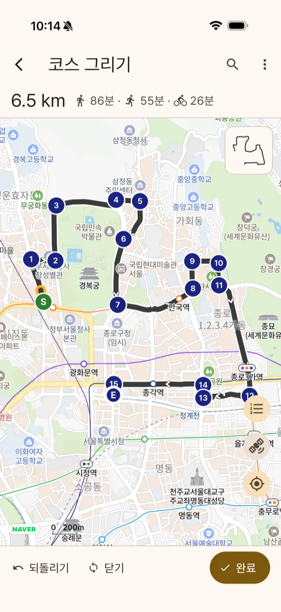

# Phase 4: 홈페이지 서비스 소개 정정 (Landing Content Fix) - Research

**Researched:** 2026-11-17
**Domain:** 정적 랜딩(`index.html`) 문구·그림 정정, 앱 스크린샷 구간(이미지 파이프라인·CSS scroll-snap), 네이버 지도 약관
**Confidence:** 문구 정정 HIGH · 스크린샷 구간 구현 MEDIUM · 네이버 지도 약관 해석 LOW~MEDIUM

> **사용자 확인 필요 (D-20, 계획 확정 전):** 네이버 지도가 보이는 앱 캡처를 홍보용 웹페이지에 써도 되는지 직접 다룬 조항은 **두 약관 어디에도 없습니다** (Q1 판정: **약관에서 찾지 못함**). 대신 Maps 서비스 이용약관 제7조 ⑨(결과 데이터 무단 복제·배포 금지)와 ⑪(결과 데이터 별도 저장·재사용 금지)이 지도 화면 이미지를 웹사이트에 올리는 일에도 걸린다고 읽힐 여지가 있습니다. 표기 문구 「지도 © NAVER Corp.」도 어느 원문에도 지정돼 있지 않습니다 (Q2-a 문구 판정: **약관에서 찾지 못함**. Q2-b 게재 의무 판정: **조건부(조건 명시)**, 회사가 요청하면 회사가 정한 로고·표시를 게재). 캡처 속 로고 처리도 캡처를 다룬 규칙은 없고, SDK 가이드의 규칙은 앱 화면 대상입니다 (Q3 판정: **약관에서 찾지 못함**). 그래서 SITE-06 스크린샷 커밋 계획을 확정하기 전에 사용자에게 아래 셋 중 하나를 고르게 해야 합니다. 자세한 근거는 「NAVER 지도 약관 확인 (D-20)」 절에 있습니다.
> 1. 위험을 알고 진행: 캡처 안의 NAVER 로고를 그대로 두고, 구간 아래에 출처를 적고, 제휴로 오인될 문구는 쓰지 않음
> 2. 진행 전에 네이버 클라우드 고객지원에 서면으로 문의
> 3. 지도가 거의 보이지 않는 화면으로 구성을 바꿈 (D-16 변경)
>
> 문구 정정(SITE-01, D-01~D-06)은 이 질문과 상관없이 바로 계획하고 배포할 수 있습니다.
>
> **→ 사용자 결정 (2026-11-17, plan-phase):** 1번 「위험을 알고 진행」. `04-CONTEXT.md` D-20에 기록했습니다.

<user_constraints>
## User Constraints (from CONTEXT.md)

### Locked Decisions

#### 이전에 정해진 것 (다시 논의하지 않음)
출처는 `.planning/ROADMAP.md`(Phase 4 External gates, Ground Rules), Phase 2 CONTEXT D-15~D-19, Phase 3 CONTEXT D-21~D-24, `CLAUDE.md` 작업 규칙입니다.

- **커밋 분리:** 문구 정정(SITE-01)과 스크린샷 추가(SITE-06)는 별도 커밋입니다. 문구 정정은 캡처를 기다리지 않고 먼저 배포할 수 있습니다. 리팩터·시각 변경·내용 변경을 한 커밋에 섞지 않습니다.
- **푸시 절차:** Claude가 푸시하되, 푸시할 때마다 `checkpoint:decision`으로 승인을 받습니다. 승인은 그 푸시 한 번에만 씁니다. 푸시 뒤에는 GitHub Pages 배포 완료를 먼저 확인하고 라이브를 확인합니다. 문제가 있으면 `git revert` → 승인 → 푸시로 먼저 되돌리고, 원인은 다음 커밋에서 고칩니다. force push와 히스토리 수정은 하지 않습니다.
- **자리표시 금지:** 캡처가 오기 전에는 빈 폰 프레임이나 「준비 중」 그림 같은 자리표시를 라이브에 올리지 않습니다. 출시 시기도 추측해서 쓰지 않습니다.
- **고정된 것:** `<title>`과 기존 URL 4개의 경로·제목은 바꾸지 않습니다. `scripts/check-site.sh` 3번 항목이 확인합니다. 푸시 전에는 로컬 Jekyll 3.10.0 빌드와 `scripts/check-site.sh`를 통과해야 합니다. pre-push 훅이 자동으로 돌립니다.
- **문서 갱신 방법:** 방침 구간은 루트 `CLAUDE.md`와 `.claude/CLAUDE.md` 두 사본을 같은 커밋에서 똑같이 고칩니다. GSD 생성 구간은 원본 맵(`.planning/codebase/*.md`)을 고친 뒤 `generate-claude-md`로 다시 만듭니다.
- **U10 결정됨:** 포인트·굿즈·코스북은 출시 범위 밖입니다.

#### 문구 정정 범위 (SITE-01)
- **D-01:** **틀린 문구만** 고칩니다. 앱에 없는 것으로 확인된 문구만 다루고, 새 기능 소개는 더하지 않습니다. 사용자는 「직접 그린 코스를 공개」 소개를 더하는 선택지를 고르지 않았습니다.
- **D-02:** 메타 설명과 OG 설명은 **지금 문장에서 포인트·굿즈·코스북 부분만 지웁니다.** 두 글은 지금처럼 따로 둡니다.
  - `<meta name="description">`: 「지도 위에 그려진 GPS 아트 코스를 따라 걷거나 뛰어 보세요. 완주하면 그 모양 그대로 뱃지가 돼요. iOS · Android 앱 출시 준비 중.」
  - `og:description`: 「GPS 아트 코스를 완주하고 코스 모양의 뱃지를 모으세요. 나만의 코스를 그려 올릴 수도 있어요.」
  - `og:title`과 `<title>`은 그대로 둡니다.
- **D-03:** 앱 범위 사실 (사용자 확인, 2026-11-16)
  - 출시 앱에는 **받은 뱃지 보관함**이 있습니다. 그래서 「보관함」이라는 단어는 써도 됩니다.
  - **못 받은 뱃지의 실루엣은 계획에 없습니다.** 「채울 뱃지」 개념도 지금은 없습니다.
  - 나중에 코스북이 도입되면 코스북 안의 못 받은 뱃지가 실루엣이 될 수 있습니다. 이는 이번 범위가 아닙니다.
- **D-04:** 「세 가지 이유」 3단계 설명 글을 바꿉니다.
  - 지금: 「끝까지 달리면 그 코스의 모양이 뱃지로 남아요. 아직 못 받은 뱃지는 회색 실루엣이에요. 하나씩 완주해 색을 채워 보세요.」
  - 바꿀 글: 「끝까지 달리면 그 코스의 모양이 뱃지로 남아요. 받은 뱃지는 보관함에 모여요. 코스를 하나씩 완주해 보관함을 채워 보세요.」
- **D-05:** 3단계 캡션 「보관함 · 받은 뱃지 4 · 채울 뱃지 3」을 「보관함 · 받은 뱃지 7」로 바꿉니다.
- **D-06:** **회색 빈 뱃지(`t-empty`) 그림을 받은 뱃지(컬러)로 바꿉니다.** 줄 길이와 배치는 그대로 둡니다.
  - 대상 1: 3단계 뱃지 줄의 3개(고양이 `rp-c-cat`, 번개 `rp-c-bolt`, 왕관 `rp-c-crown`)
  - 대상 2: 「세 가지 이유」 오른쪽 패널 장식 스티커(`.rp-stickers`)의 `t-empty` 2개
  - 색은 이미 있는 뱃지 색 클래스(`t-yellow`·`t-red`·`t-kraft`·`t-graph`·`t-graphite`) 안에서 고르고, 새 hex는 만들지 않습니다.
- **D-07:** 나머지 본문은 출시 앱에 모두 들어간다고 사용자가 확인했습니다. 그래서 그대로 둡니다.
  - 1단계: 점 찍어 길 따라 그리기, 되돌리기·이어 그리기, 장소 검색, 닫기, 걷기·달리기·자전거 예상 시간
  - 2단계: 실시간 진행률, 거리·페이스
  - 3단계 결과 화면과 뱃지 창, 「달려 보기」 완료 문구 「진짜 길에서 완주하면 보관함에 차곡차곡 쌓여요」, 히어로의 자전거 캐릭터

#### 출시 전 표시
- **D-08:** 화면 문구는 **「출시 준비 중」을 그대로** 씁니다. 「출시 예정」으로 바꾸지 않습니다.
  - 그대로 두는 곳: 히어로 딱지(162행), 출시 안내 제목 위(403행), 스케치 캡션(418행), `aria-label="출시 준비 안내"`(400행), 메타 설명 끝.
  - **「출시 예정」이 적힌 기준 문장 세 곳을 고칩니다.** 「출시 예정」 표시를 「출시 전임을 알리는 표시(현재 「출시 준비 중」)」로 바꿉니다. 근거는 Phase 2 UAT에서 기준 문구를 고친 선례입니다. 검증자는 Goal과 요구사항 문장부터 읽으므로 세 곳을 모두 고칩니다.
    - `.planning/ROADMAP.md` Phase 4의 **Goal** 줄 (「실제 앱 화면과 「출시 예정」 표시가 보인다」)
    - `.planning/ROADMAP.md` Phase 4 **성공 기준 2**
    - `.planning/REQUIREMENTS.md` **SITE-06**
  - 이 단계의 첫 문서 커밋에서 Edit로 고친 뒤 `roadmap validate`로 확인합니다.
  - 참고: Phase 9 성공 기준 2(`/en/`)의 「출시 예정 표시」는 영문판의 몫이라 이 단계에서 고치지 않습니다. 영문판에서 어떤 영어 표현을 쓸지는 Phase 9에서 정합니다.
- **D-09:** **출시 시기는 적지 않습니다.** 앱 일정이 유동적이라, 지난 날짜가 남아 방치된 사이트처럼 보일 위험을 피합니다.
- **D-10:** 스크린샷 구간에는 **구간 제목 옆에 히어로와 같은 모양의 「출시 준비 중」 딱지**를 둡니다. 「개발 중인 화면이라 달라질 수 있어요」 같은 주의 문구는 더하지 않습니다.

#### 스크린샷 구간 (SITE-06)
- **D-11:** **새 구간**을 「달려 보기」(`#demo`)와 「출시 안내」(`#get`) 사이에 둡니다.
  - 「세 가지 이유」의 그린 폰 목업은 바꾸지 않습니다. 스크립트가 `data-step` 요소 6개와 `rp-run-*` id를 null 확인 없이 쓰므로, 바꾸면 성공 기준 3이 깨질 위험이 있습니다.
  - 고른 방향: 제목 「실제 앱 화면」 + 「출시 준비 중」 딱지 → 폰 3장 → 장마다 짧은 캡션(예: 코스 그리기 · 따라 달리기 · 완주하고 뱃지 받기).
- **D-12:** 각 스크린샷은 「세 가지 이유」 그린 폰과 **같은 흑연 폰 테두리**로 감쌉니다. 테두리는 CSS로 씁니다(`#1F1B13`, 모서리 반경 46px, 안쪽 9px, 그림자 `0 28px 56px rgba(31, 27, 19, 0.28)`). 캡처의 상태 표시줄은 테두리 안에 그대로 보입니다.
- **D-13:** **3장**입니다.
- **D-14:** 배치
  - 넓은 화면(1280px 등)에서는 한 줄에 3장을 둡니다.
  - **좁은 화면(375px)에서는 한 줄 그대로 가로로 밀어 봅니다.**
    - CSS `scroll-snap`만 쓰고 스크립트는 쓰지 않습니다.
    - 다음 장이 조금 보이게 해서 밀 수 있음을 알립니다.
    - 키보드로도 밀 수 있게 합니다.
    - 페이지 자체는 가로로 밀리면 안 됩니다(`scrollWidth`가 화면 폭 이하).
- **D-15:** 헤더 메뉴는 **그대로** 둡니다(즐기는 법·달려 보기·출시 안내). 새 구간 링크를 넣지 않으므로 공유 include `_includes/header.html`과 법적 3종의 출력이 바뀌지 않습니다. 헤더는 Phase 5에서 지원 페이지 링크를 더할 때 다시 봅니다.

#### 캡처 구성과 지도 출처
- **D-16:** 화면 3장의 구성
  - ① 코스 그리기: 에디터. 지도에 선이 이어진 상태
  - ② 따라 달리기: 진행률·움직인 시간·거리·평균 페이스
  - ③ 완주 결과와 뱃지 창
  - 「세 가지 이유」와 같은 흐름입니다.
- **D-17:** **하단 탭(홈·코스·업적·명예의 전당·피드)이 보이지 않는 화면만** 씁니다. 업적·명예의 전당·피드는 「곧 열려요」 상태라 성공 기준 2의 「출시 범위 밖 기능」에 걸릴 수 있습니다.
  - 탭이 보이면 **다시 찍기가 먼저**입니다. 잘라내야 하면 세 장 모두 같은 비율로 자릅니다. 한 장만 자르면 화면 비율이 달라져 D-18과 부딪힙니다.
- **D-18:** **iPhone 한 기기로** 세 장 모두 찍습니다. App Store 심사자는 iPhone과 Safari로 볼 가능성이 높습니다. 장마다 화면 비율과 상태 표시줄도 같아야 합니다.
- **D-19:** `.planning/baseline/USER-TASKS.md` 작업 10의 조건도 그대로 지킵니다.
  - 포인트·굿즈·코스북 화면이 없어야 합니다.
  - 「Dev」 표시가 없어야 합니다.
  - 시험 계정과 시험 경로로 찍어 실명·계정 주소·집 근처 위치가 보이지 않아야 합니다.
  - 캡처는 사용자가 Claude에게 넘기고, 사이트에 넣을 파일은 Claude가 정리해 커밋합니다.
  - **작업 10의 「순서」를 이 단계 결정에 맞게 고칩니다.** 들어갈 내용은 iPhone 한 기기, 화면 3장(D-16), 하단 탭 없음(D-17), NAVER 로고와 지도 저작권 표시 유지(D-20)입니다. 지금 작업 10의 예시(「코스 둘러보기, 코스 기록 중, 완주 뱃지」)는 D-16과 다릅니다. 둘러보기 화면에는 하단 탭이 보일 가능성도 큽니다. 사용자가 보는 캡처 절차서는 작업 10뿐입니다. 그래서 이 갱신은 이 단계의 첫 문서 커밋에 넣어, 사용자가 캡처하기 전에 반영되게 합니다.
- **D-20:** 지도 출처
  - **캡처 안의 NAVER 로고와 지도 저작권 표시는 잘라내지 않습니다.** 앱 지도는 네이버 지도(`flutter_naver_map`)입니다.
  - **지도 출처는 스크린샷 구간 바로 아래에 작은 글씨로 씁니다.** 랜딩에만 넣고, 법적 페이지와 함께 쓰는 공유 푸터는 건드리지 않습니다.
  - 표기 문구(예: 「지도 © NAVER Corp.」)와 캡처를 홍보용 웹페이지에 써도 되는지는 **연구 단계에서 네이버 클라우드 Maps 서비스 이용약관과 NAVER API 이용약관으로 확인합니다.**
  - 논의 중 조사로 확인한 것은 둘입니다. Maps 이용약관에 「회사가 결과물에 로고·지정 표시 게재를 요청할 수 있다」는 조항이 있고, 운영자 FAQ에 「로고가 가려지지 않아야 한다」는 안내가 있습니다. 캡처 재사용을 직접 다룬 조항은 찾지 못했습니다.
  - 약관이 캡처 사용을 막거나 다른 표기를 요구하면, 계획을 확정하기 전에 사용자에게 다시 묻습니다.
  - **ROADMAP과의 차이:** ROADMAP Phase 4는 「Research flag: 아니요」입니다. 하지만 이 지도 약관 확인 때문에 이 단계는 **연구가 필요합니다.** 계획할 때 연구를 건너뛰지 않습니다(`--skip-research` 쓰지 않음).

#### 배포 순서
- **D-21:** **캡처는 아직 없습니다.** 문구 정정(D-01~D-06)을 먼저 커밋하고 배포합니다.
  - 스크린샷 구간(D-10~D-20)은 캡처가 온 뒤에 따로 커밋하고 배포합니다.
  - 그 사이 단계는 열려 있습니다. Phase 5를 먼저 진행해도 됩니다(ROADMAP Progress).
  - 스크린샷 구간의 마크업·CSS는 캡처 없이 라이브에 올리지 않습니다(자리표시 금지).
- **D-22:** 커밋을 나누는 단위
  - 문구 커밋(메타·OG·3단계 글·캡션)
  - 빈 뱃지 컬러 커밋(D-06): 내용을 바로잡으려는 변경이지만 그림이 바뀝니다. 그래서 문구 커밋과 나눕니다. 같은 푸시에 넣는 것은 괜찮습니다.
  - 스크린샷 구간 커밋(이미지 + 마크업 + CSS)
  - 문서 커밋
  - 첫 푸시에는 문구 커밋과 빈 뱃지 커밋이 들어갑니다. 스크린샷 푸시는 캡처가 온 뒤입니다. 문서 커밋을 각 푸시에 어떻게 붙일지는 Claude's Discretion입니다. 다만 사이트가 되돌려져도 문서가 사이트와 어긋나지 않게 합니다(Phase 3 D-21의 원칙: 라이브 확인 뒤 문서 푸시).

#### 문서 갱신 (이 단계 안에서, Ground Rule)
- **D-23:** 방침 표 「포인트·굿즈·코스북 제거」 행의 현재 상태 칸을 「랜딩은 Phase 4에서 제거됨, 법적 문서 본문에는 남아 있음」으로 고칩니다. 두 사본(루트 `CLAUDE.md`, `.claude/CLAUDE.md`)을 같은 커밋에서 고칩니다. 이 갱신은 문구 정정 푸시가 라이브 확인을 통과한 뒤에 합니다.
- **D-24:** 스크린샷 구간이 들어가면 「모두 인라인 SVG, 외부 이미지 없음」 규칙이 바뀝니다. 같은 단계에서 아래를 함께 고칩니다.
  - **루트 `CLAUDE.md`:** Pages 표의 랜딩 구간 목록, Architecture 「로고·아이콘·지도 그림은 모두 인라인 SVG」 문단, 푸터 문단의 「실제 지도를 쓰게 되면 출처 표기를 더한다」(스크린샷 구간 아래 표기로 해소), Assets에 스크린샷 폴더
  - **원본 맵:** `.planning/codebase/CONVENTIONS.md`(「외부 이미지 파일을 쓰지 않는다」), `ARCHITECTURE.md`(Component 표·SVG 설명), `STRUCTURE.md`, `STACK.md`
  - 그 뒤 `generate-claude-md`로 `.claude/CLAUDE.md`를 다시 만듭니다.
  - `.planning/PROJECT.md`의 Active 체크와 「현재 사이트」 설명은 이전 단계처럼 단계 전환 갱신에서 고칩니다.

### Claude's Discretion
- **이미지 처리:** 형식(WebP·AVIF·PNG, `<picture>` 사용 여부), 해상도와 고배율(`srcset`), 파일 크기 상한, 폴더 위치와 파일 이름(kebab-case, 예: `/images/…`), `width`·`height` 속성(레이아웃 밀림 방지), `loading="lazy"`·`decoding="async"`. 이미지 메타데이터(EXIF 등)는 지우고 올리기를 권합니다. 새 폴더가 `_config.yml`의 `exclude`에 걸리지 않는지 확인합니다.
- **새 구간의 이름과 모양:**
  - id·클래스 이름은 `rp-` 접두사를 쓰고, 스크립트가 쓰는 이름과 겹치지 않게 합니다.
  - 바탕색은 기존 색 토큰 안에서 고릅니다.
  - 제목·캡션 문구는 D-11의 방향 안에서 다듬습니다.
  - 각 이미지의 `alt` 문구를 씁니다.
  - 가로 스크롤 컨테이너의 키보드 접근 방식을 정합니다(법적 표의 `tabindex="0"` + `aria-label` 선례).
- **「출시 안내」와의 맞물림:** `.rp-get`은 음수 `margin-top`으로 「달려 보기」의 둥근 아래 모서리 밑에 들어가 있습니다. 새 구간이 사이에 들어가면 이 맞물림을 어떻게 이을지 정합니다. UI 설계 계약(`/gsd-ui-phase`)을 만들면 거기서 정해도 됩니다.
- **세부 조정:** 빈 뱃지를 바꿀 색의 배치(D-06), 메타·OG 문장의 띄어쓰기 같은 미세 다듬기. 의미는 바꾸지 않습니다.
- **검증 도구:** Playwright 스크래치 스크립트를 쓴다면 pnpm으로 설치하고 커밋하지 않습니다. 확인할 것은 셋입니다.
  - **성공 기준 3:** 「세 가지 이유」 고정 스크롤, 7초 달려 보기, 움직임 줄이기, 콘솔 오류 0을 Chromium·WebKit에서 봅니다.
  - **성공 기준 2:** 375·1280px 화면을 봅니다.
  - **의도한 줄만 바뀜:** 문구 커밋 전후 `_site/index.html`의 diff가 의도한 줄만인지 봅니다.

### Deferred Ideas (OUT OF SCOPE)
- **코스북 도입 시 못 받은 뱃지 실루엣:** 앱 v2(P2-05 코스북)가 들어오면 코스북 안의 못 받은 뱃지를 실루엣으로 보이게 될 수 있습니다. 그때 사이트 소개도 다시 봅니다. 이번 마일스톤 범위 밖입니다.
- **헤더 메뉴 정비:** 새 스크린샷 구간 링크는 넣지 않았습니다. Phase 5에서 지원 페이지 링크를 더할 때 헤더를 다시 봅니다.
</user_constraints>

<phase_requirements>
## Phase Requirements

| ID | Description | Research Support |
|----|-------------|------------------|
| SITE-01 | 심사자는 홈페이지의 소개 문구·메타 설명·OG에서 출시 시점 앱에 없는 기능(포인트·기념 굿즈·코스북)을 보지 않는다 | 「현재 코드 위치」 절: 세 단어는 빌드 결과 `_site/index.html`의 메타(출력 10행)·OG(출력 15행) 두 줄에만 있음을 이 세션 빌드로 확인. D-04·D-05·D-06 대상 줄 원문 인용. 「check-site.sh에 SC1 점검을 넣을지」 절 |
| SITE-06 | 심사자는 홈페이지에서 실제 앱 화면(스크린샷)과 「출시 예정」 표시를 보고, 출시 전이어도 서비스 내용을 확인할 수 있다 (D-08: 기준 문장을 「출시 전임을 알리는 표시(현재 「출시 준비 중」)」로 고칠 예정) | 「NAVER 지도 약관 확인」, 「이미지 파이프라인」, 「가로 스크롤 띠」, 「#demo와 #get 사이에 끼우기」 절, Validation Architecture |
</phase_requirements>

## Project Constraints (from CLAUDE.md)

계획이 지켜야 하는 지시입니다. 출처는 루트 `CLAUDE.md`, `.claude/CLAUDE.md`, 전역 `~/.claude/CLAUDE.md`입니다.

- `main` 푸시가 곧 배포입니다. 모든 단계는 그대로 라이브에 올라가도 되는 상태로 끝냅니다.
- `/privacy-policy/`, `/terms/`, `/data-deletion/` 경로를 바꾸지 않고 리디렉션도 걸지 않습니다. 배포마다 세 URL의 200과 제목을 확인합니다.
- 리팩터·시각 변경·내용 변경을 한 커밋에 섞지 않습니다.
- 푸시 전에 로컬 Jekyll 3.10.0 빌드와 `scripts/check-site.sh`가 통과해야 합니다.
- 「추후 기재」 같은 자리표시 값을 쓰지 않습니다. 사용자가 줄 사실값은 추측하지 않습니다.
- JS 언어 자동 리디렉션, `robots.txt` 차단, `.nojekyll`, Jekyll i18n 플러그인을 쓰지 않습니다.
- 방침·구조를 바꾸는 단계는 같은 단계 안에서 `CLAUDE.md`를 고칩니다. 방침 구간은 두 사본을 같은 커밋에서 똑같이 고치고, `.claude/CLAUDE.md`의 생성 구간은 원본 맵을 고친 뒤 `node ~/.claude/gsd-core/bin/gsd-tools.cjs generate-claude-md`로 다시 만듭니다.
- 랜딩 스타일: 새 스타일은 「랜딩 전용」 묶음에 넣습니다. 좁은 화면 규칙은 `@media (max-width: 860px)` 한 블록에 모읍니다. CSS 규칙은 한 줄에 하나, 들여쓰기 공백 4칸, 클래스는 `rp-` + kebab-case, 구획 머리 주석은 `/* ── 이름 ── */`입니다.
- 노랑 `#F2B134`는 밝은 바탕 위 글자·밑줄에 쓰지 않습니다. 다크 모드는 넣지 않습니다. 클릭 대상은 44px 이상, 포커스는 `:focus-visible`(3px `#1E5AA8`)로 보입니다.
- 움직임은 `@media (prefers-reduced-motion: reduce)`와 JS `reduced()` 둘 다로 막습니다.
- 스크립트가 쓰는 id·class·data 속성(`story`, `rp-panel`, `rp-run-*`, `rp-demo-*`, `rp-hero-art`, `rp-sketch`, `rp-c-dog`, `data-step`, `data-go`)은 이름을 바꾸지 않습니다. 새 구간은 이 이름을 쓰지 않습니다.
- front matter가 붙은 파일은 전체가 Liquid를 거칩니다. 인라인 CSS·JS에 이중 중괄호·중괄호-퍼센트가 생기면 ``로 감쌉니다. include 태그는 0열에 혼자 둡니다.
- 새 루트 파일·폴더를 만들면 `_config.yml` `exclude`를 확인합니다 (사이트에 올릴 이미지 폴더는 `exclude`에 넣지 않습니다).
- 커밋 메시지는 Conventional Commits, prefix 영어, 제목·본문 한국어입니다. 전역 규칙의 「린터 실행」은 `scripts/check-site.sh`로 갈음합니다.
- 설치는 npm 대신 pnpm을 씁니다 (사용자 메모리, Phase 3 실행 기록 03-01).
- 검증 도구(Playwright 스크래치)는 커밋하지 않습니다.

## Summary

이 단계는 두 갈래이고 서로 막지 않습니다. **문구 정정(SITE-01)** 은 지금 바로 할 수 있습니다. 이 세션에서 HEAD를 운영과 같은 방식(production, `--safe`)으로 빌드해 보니 「포인트·굿즈·코스북」은 `_site/index.html`의 메타 설명(출력 10행)과 OG 설명(출력 15행) 두 줄에만 있었습니다. 원본으로는 `index.html` 13행과 18행입니다. JSON-LD, 매니페스트, `alt`, 본문에는 없습니다. 법적 세 문서에는 각각 6·6·3줄이 남아 있으므로, 성공 기준 1의 검색은 `_site/index.html` 하나로 범위를 좁혀야 합니다. 그 밖의 정정 대상(D-04 234행, D-05 245행, D-06 241~243·260·262행)도 원문을 확인했습니다. 회색 실루엣 색(`#EEEEEE` 등)은 51행 `.rp-badge.t-empty` 규칙에만 있어서, D-06 뒤에는 이 규칙을 쓰는 곳이 없어집니다.

**스크린샷 구간(SITE-06)** 은 캡처가 와야 시작합니다. 구현 쪽으로는 이 기계에 있는 `sips`(색 공간을 sRGB로 바꾸고 크기 줄이기)와 `cwebp` 1.6.0(WebP 인코딩, 메타데이터 기본 제거)만으로 충분합니다. `avifenc`·ImageMagick·`exiftool`은 없습니다. 이미지는 `` WebP 한 가지로 두고, 표시 폭 약 282px의 2배·3배(564w·846w)를 만듭니다. 375px에서는 CSS `scroll-snap` 가로 띠로 바꾸고, 띠에 `tabindex="0"`과 `aria-label`을 줍니다 (법적 표 `<figure>` 선례). 배치에서 주의할 함정이 둘 있습니다.
1. `.rp-get`은 음수 `margin-top`으로 바로 앞 구간 밑으로 들어갑니다. 그래서 새 구간이 `position: relative; z-index: 1`과 둥근 아래 모서리를 갖지 않으면, 「출시 안내」의 노랑 바탕이 새 구간 아래쪽 28~56px(아래 안쪽 여백 일부)를 덮어 모서리가 각지게 잘려 보입니다. 새 구간의 아래 안쪽 여백(56~104px)이 겹침보다 커서 출처 표기 줄 자체는 가려지지 않지만, 지금의 「둥근 모서리 밑으로 들어가는」 모양을 이어 가려면 이 처리가 필요합니다.
2. `overflow-x: auto` 띠는 세로 방향도 잘라서 폰 그림자(56px blur)가 잘립니다.

**네이버 지도 약관**은 결론이 깔끔하지 않습니다. 캡처를 홍보 페이지에 쓰는 일을 직접 다룬 조항이 없습니다. 대신 「결과 데이터」의 복제·배포·별도 저장을 금지하는 조항(Maps 약관 제7조 ⑨⑪)이 있어 넓게 읽으면 걸릴 수 있습니다. 그래서 문서 머리에 사용자 확인 항목으로 올렸습니다. 로고 규칙은 SDK 가이드에 있지만 「앱의 UI 요소에 가려지지 않도록」이라는 앱 화면 규칙이고, 캡처를 다루지 않습니다. 운영자 FAQ 페이지는 도메인이 DNS에서 풀리지 않아 이 세션에서 **가져오지 못했습니다**.

**Primary recommendation:** 문구 커밋 → 빈 뱃지 컬러 커밋을 첫 푸시로 내고, 라이브 확인 뒤 문서 커밋(D-08 기준 문장 3곳, 작업 10 갱신, D-23)을 푸시합니다. 스크린샷 구간은 사용자가 지도 약관 질문에 답하고 캡처를 준 뒤에 계획을 확정합니다. 이때 `sips --matchTo sRGB` → `sips --resampleWidth` → `cwebp -q 80 -m 6 -sharp_yuv` 순서로 이미지를 만들고, 새 구간에 `z-index: 1`과 둥근 아래 모서리를 줍니다.

## Architectural Responsibility Map

| Capability | Primary Tier | Secondary Tier | Rationale |
|------------|-------------|----------------|-----------|
| 메타·OG 설명 정정 | CDN / Static (빌드된 HTML `<head>`) | — | 서버가 없습니다. 크롤러와 공유 미리보기가 정적 HTML을 그대로 읽습니다 |
| 3단계 글·캡션·뱃지 색 | CDN / Static (HTML + 인라인 CSS 클래스) | Browser (기존 스크립트가 `is-on` 토글만 함) | 스크립트는 `data-step`과 클래스 토글에만 기댑니다. 글과 색 클래스는 스크립트 계약 밖입니다 |
| 스크린샷 이미지 | CDN / Static (`/images/…` 정적 파일, GitHub Pages) | Browser (`srcset`에서 해상도 고름, lazy 로딩) | 빌드 도구가 없어 이미지는 커밋 전에 로컬에서 만듭니다. Jekyll은 front matter 없는 파일을 그대로 복사합니다 |
| 375px 가로 밀기 | Browser (CSS `scroll-snap`, 스크립트 없음) | — | D-14가 스크립트를 금지합니다 |
| 지도 출처 표기 | CDN / Static (랜딩 마크업) | — | D-20: 랜딩에만 둡니다. 공유 푸터는 건드리지 않습니다 |
| SC1 재유입 차단 | 빌드 점검 (`scripts/check-site.sh`, pre-push) | — | CI가 없어 푸시 전 로컬 점검이 유일한 관문입니다 |

## NAVER 지도 약관 확인 (D-20)

### 어떤 약관이 무엇을 다루나

| 앱 기능 | 제공 경로 | 적용 약관 | 근거 |
|---|---|---|---|
| 지도 표시 (`flutter_naver_map`, 지도 타일) | 네이버 클라우드 플랫폼 Maps | **네이버 클라우드 플랫폼 Maps 서비스 이용약관** (부칙: 2025-03-20 적용) | `.planning/baseline/DATA-INVENTORY.md:207` 「네이버 지도 SDK (`flutter_naver_map`) … 네이버클라우드」 [VERIFIED: 저장소 grep] |
| 장소 검색 (지오코딩) | NCP Geocoding·Reverse Geocoding | Maps 서비스 이용약관 | `DATA-INVENTORY.md:205` 「네이버클라우드 (NCP Geocoding·Reverse Geocoding, NAVER API HUB 지역검색)」 [VERIFIED: 저장소 grep] |
| 장소 검색 (지역검색 결과) | NAVER API HUB | **NAVER API 서비스 이용약관** (2026-06-25 시행) | 같은 행 |

- Maps 약관 PDF는 지금도 정본입니다. `https://www.ncloud.com/policy/terms/svc`의 약관 목록에서 「Maps 서비스 이용약관」이 가리키는 파일이 CONTEXT의 PDF와 같은 `[민간]Maps서비스이용약관_v0.4_(CLEAN)_1742433558704.pdf`입니다. [VERIFIED: curl로 받은 정책 페이지에서 이 세션에 확인]
- **계획에 넣을 것:** 캡처 ①(코스 그리기)에 **장소 검색 결과 목록이 보이지 않게** 합니다. 그 목록은 API HUB 지역검색의 결과 화면이라, API HUB 약관 7.3 ③(「API 서비스를 이용하여 취득한 정보 … 무단으로 복제, 저장(캐시 행위 포함), 가공, 배포」 금지)과 ④(「API의 결과화면과 함께 광고를 노출하는 행위」)가 더 직접 걸립니다. 작업 10 갱신(D-19)에 이 조건을 더합니다.

### Q1. 우리 앱의 네이버 지도가 보이는 캡처를 홍보·티저 페이지(runningpencil.com)에 써도 되나?

**판정: 약관에서 찾지 못함** (명시적으로 허용하는 조항도, 명시적으로 금지하는 조항도 없음) → **사용자 확인 필요**

두 약관 어디에도 「캡처」「스크린샷」「홍보」「마케팅」을 다룬 조항은 없습니다. 다만 아래 조항들은 넓게 읽으면 웹페이지에 지도 화면 이미지를 올리는 일에도 걸릴 수 있습니다. 「결과 데이터」가 지도 타일 이미지까지 포함하는지는 약관이 정의하지 않습니다.

- Maps 서비스 이용약관 **제7조 ⑨**: 「‘고객’은 ‘회사’의 사전 동의 없이 ‘본 서비스’의 결과 데이터를 본 약관에서 허용한 범위를 넘어서서 무단으로 복제, 저장, 가공, 배포하거나 제3자에게 제공해서는 안됩니다.」 [CITED: Maps 서비스 이용약관 PDF 2쪽, 이 세션에 받아 읽음]
- Maps 서비스 이용약관 **제7조 ⑪**: 「‘고객’은 ‘본 서비스’의 결과 데이터를 (해당 결과 데이터를 받은 즉시 자신의 서비스에서 사용하는 것이 아니라) 별도로 저장해서는 안되며 … 즉, 모든 Maps API의 결과 데이터는 값을 리턴 받는 즉시 1회 자신의 서비스에서 사용하는 것만 허용되며, 그렇지 않고 그 결과 값들을 별도로 저장, DB화, 재사용하는 것은 금지됩니다.」 조항의 예시는 「지도 좌표 데이터를 모아서 … 재사용하는 것」입니다. [CITED: 같은 PDF 2쪽]
- Maps 서비스 이용약관 **제7조 ⑬**: 「‘회사’는 ‘본 서비스’의 적법, 건전한 운영을 위해 산출물 등 결과물 및 외부 송출 내역을 모니터링할 수 있으며, … 산출물 등 결과물의 삭제 및 고객의 서비스 이용을 중단하는 등의 조치를 할 수 있습니다.」 [CITED: 같은 PDF 3쪽]
- Maps 서비스 이용약관 **제7조 ①**: 사용권은 「본 약관, ‘홈페이지’ 등에서 허용하는 범위 내」이고 「결과 데이터에 대한 권리의 취득을 의미하지 않습니다.」 [CITED: 같은 PDF 2쪽]
- NAVER API 서비스 이용약관 **8.1**: 「API서비스를 이용한 결과 데이터의 저작권 등 제반 권리는 네이버 또는 원저작자 등 제3자에게 있습니다.」 [CITED: NAVER API 서비스 이용약관 PDF 5쪽]

해석 메모: ⑪의 문맥(좌표 데이터베이스화)은 캡처 이미지를 겨냥한 조항이 아니라고 읽을 수도 있습니다. 반대로 ⑨는 문구가 넓어 「복제·배포」에 이미지가 들어간다고 읽을 수도 있습니다. 어느 쪽으로 읽을지는 법률 판단이라 이 연구가 정하지 않습니다. 스토어 스크린샷에 지도 앱 화면이 흔히 쓰인다는 관행도 근거로 쓰지 않습니다. 이 세션에 확인하지 않은 일반 지식입니다 [ASSUMED].

사용자에게 줄 선택지 (머리말의 1~3과 같음):
1. 위험을 알고 진행합니다. 로고를 그대로 두고(Q3), 출처를 적고(Q2), 제휴로 오인될 문구는 쓰지 않습니다.
2. 네이버 클라우드 고객지원에 서면으로 문의한 뒤 진행합니다. 답을 기다리는 동안 스크린샷 푸시는 멈추고, 문구 정정은 따로 배포합니다.
3. 지도가 거의 보이지 않는 화면(예: ③ 뱃지 창만 크게 보이는 장면)으로 D-16을 바꿉니다. 이 경우 「세 가지 이유」의 흐름과 맞지 않게 됩니다.

### Q2. 캡처 옆에 어떤 출처 문구가 필요하거나 권장되나? 어디에 둬야 하나?

질문을 둘로 나눠 판정합니다.
- **Q2-a (어떤 문구를 써야 하나, 어디에 둬야 하나) 판정: 약관에서 찾지 못함**
- **Q2-b (출처·로고 게재 의무가 있나) 판정: 조건부(조건 명시: 회사가 정책에 따라 요청하면, 회사의 로고나 회사가 지정한 표시를 결과 데이터나 「애플리케이션 등」에 게재해야 함)**

- Maps 서비스 이용약관 **제7조 ⑩**: 「‘회사’는 ‘회사’의 정책에 따라 ‘고객’이 ‘본 서비스’를 이용하여 산출한 모든 결과 데이터 또는 ‘애플리케이션 등’에 ‘회사’의 로고 또는 ‘회사’가 지정한 표시의 게재를 요청할 수 있으며, ‘고객’은 이를 준수하여야 합니다.」 [CITED: Maps 약관 PDF 2쪽]. 여기서 「회사」는 네이버 클라우드 주식회사입니다(제1조). 「애플리케이션 등」에는 「웹사이트 등」이 들어갑니다(제2조 ① 6호).
- Maps 서비스 이용약관 **제7조 ⑦**: 「‘고객’은 ‘본 서비스’의 사용과 관련하여 ‘홈페이지’에서 별도로 제공되는 ‘Maps 사용 가이드’ 및 ‘API 가이드’를 준수해야 합니다.」 [CITED: Maps 약관 PDF 2쪽]. 사용 가이드(`guide.ncloud-docs.com/docs/application-maps-procedure`) **한 쪽**만 읽었고, 거기서 찾은 표기 규정은 명칭 규정뿐입니다: 「네이버 Maps에서 제공하고 있는 기능 및 서비스 명칭을 임의로 변경할 수 없으며」 [CITED: guide.ncloud-docs.com, WebFetch 요약 경유]. 그 쪽에 출처 문구 규정은 없었습니다. curl로 받은 원문은 403이었으므로 요약 경유로만 읽었습니다. ⑦이 끌어오는 「Maps 사용 가이드」「API 가이드」의 다른 쪽까지 모두 확인한 것은 아니므로, 「가이드 전체에 출처 규정이 없다」고 읽지 않습니다.
- NAVER API 서비스 이용약관 **7.3 ⑦**: 「API 서비스의 제공주체 및 제휴관계 등에 대해서 오인을 받을 수 있는 외관을 형성하는 행위」 금지. 예시는 「이용자와 네이버 또는 네이버클라우드 사이에 제휴 관계가 존재하는 것으로 오인할 수 있는 외관을 형성하는 행위」입니다. 같은 약관 **7.3 ⑧**은 「네이버의 브랜드를 모방, 도용하는 행위」를 금지합니다. [CITED: API 약관 PDF 4쪽]. API HUB 약관이 직접 다루는 것은 지역검색이지만, 표기 문구를 정할 때 지킬 선으로 씁니다.
- **문구 「지도 © NAVER Corp.」는 이 세션에 읽은 원문 어디에도 없습니다** [ASSUMED]. 저작권 귀속 표기 형식이고, 「제휴」「공식」「네이버와 함께」 같은 말이 없어 7.3 ⑦에 걸리지 않는 모양이라는 정도만 말할 수 있습니다.
- **위치:** 약관에서 찾지 못함. D-20 결정(스크린샷 구간 바로 아래 작은 글씨)을 따릅니다. 이 줄이 화면에서 실제로 보이는지는 「#demo와 #get 사이에 끼우기」 절의 함정 때문에 검증해야 합니다.

### Q3. 캡처 안의 NAVER 로고·저작권 표시는 어떻게 다루나? 크기·위치 규칙이 있나?

**판정: 약관에서 찾지 못함** (캡처 이미지나 웹 게시물 속 로고를 다룬 규칙, 크기·위치 규칙 모두 없음)

가장 가까운 규정은 아래 SDK 가이드 문장입니다. 이 문장은 「앱의 UI 요소」, 즉 실행 중인 앱 화면을 대상으로 합니다. 그래서 캡처에 대한 판정 근거로 쓰지 않고, D-20(로고를 자르지 않음)을 뒷받침하는 인접 규정으로만 적습니다.

- NAVER 지도 iOS SDK 가이드(한국어, 「사용자 인터페이스」 4-1): 「네이버 로고는 비활성화할 수 없으나, 위치를 조정하거나 탭을 비활성화할 수는 있습니다. 네이버 지도 SDK를 사용하는 앱은 반드시 네이버 로고가 앱의 UI 요소에 가려지지 않도록 해야 합니다.」 [VERIFIED: `navermaps.github.io/ios-map-sdk/guide-ko/4-1.html`을 curl로 받아 원문을 grep]
- 같은 가이드: 「logoAlign 속성으로 위치를, logoMargin 속성으로 마진을 지정해 위치를 조정할 수 있습니다.」 「로고 탭을 비활성화한 앱은 반드시 앱 내에 네이버 지도 SDK의 법적 공지(-showLegalNotice) 및 오픈소스 라이선스(-showOpenSourceLicense)뷰를 보여주는 메뉴를 만들어야 합니다.」 [VERIFIED: 같은 원문을 curl로 받아 grep]
- Android SDK 가이드도 같은 뜻의 문장을 둡니다: 「logoGravity 속성으로 그래비티를, logoMargin 속성으로 마진을 지정해 위치를 조정할 수 있습니다.」, 로고 클릭을 끈 앱은 「법적 공지 액티비티(LegalNoticeActivity) 및 오픈소스 라이선스 액티비티(OpenSourceLicenseActivity)로 연결되는 메뉴를 만들어야 합니다.」 [VERIFIED: `navermaps.github.io/android-map-sdk/guide-ko/4-1.html` curl 원문 grep]
- 가이드는 지도 위 표시로 **로고만** 말합니다. 지도 위 저작권 글자(© …)를 그린다는 내용은 없습니다. 로고를 누르면 「범례, 법적 공지, 오픈소스 라이선스」가 열린다고만 적습니다. 그래서 검증에서 캡처 안의 「저작권 글자」를 찾는 항목은 넣지 않습니다. 확인할 것은 **NAVER 로고가 온전히 보이는지**입니다.
- `flutter_naver_map`은 네이티브 SDK를 감싼 플러그인이라 같은 규칙이 앱에 적용된다고 봅니다. 플러그인 문서에서 로고 문장은 찾지 못했습니다 [ASSUMED].
- **운영자 FAQ(`ncloud-forums.com`)는 가져오지 못했습니다.** `www.ncloud-forums.com`이 로컬 DNS와 공용 DNS(8.8.8.8) 모두에서 풀리지 않았습니다. Wayback CDX에는 프로필 첫 페이지 하나(2026-06-04)만 있었고, 그 사본에는 「로고」「캡처」「저작권」 글자가 없었습니다. 요청한 2쪽은 보관본이 없습니다. CONTEXT D-20의 「로고가 가려지지 않아야 한다」 FAQ 내용은 이 세션에서 다시 확인하지 못했습니다. 다만 같은 취지의 문장이 SDK 가이드에 있으므로 결론은 바뀌지 않습니다.

계획에 넣을 것:
- 캡처를 자르거나 덮지 않습니다 (D-20). 「출시 준비 중」 딱지, 캡션, 그림자 등 웹페이지 요소를 이미지 위에 겹치지 않습니다.
- **D-12 폰 테두리 안쪽 반경 37px(`overflow: hidden` 또는 `img`의 `border-radius`)이 화면 아래 모서리의 로고를 깎을 수 있습니다.** 375·1280px 캡처에서 로고가 온전히 보이는지 사람이 확인하는 항목을 둡니다. 깎이면 안쪽 반경을 줄이거나 테두리 안쪽 여백을 늘립니다. 로고는 지울 수 없습니다.
- 로고 위치는 앱 설정(`logoAlign`·`logoMargin`)과 바텀시트에 따라 달라지므로, 캡처가 온 뒤 장마다 위치를 기록합니다.

## 현재 코드 위치 (D-02·D-04·D-05·D-06)

모든 인용은 이 세션에 `Read`로 연 `index.html`에서 그대로 옮겼습니다.

### D-02 메타·OG [VERIFIED: index.html:11-19]

```html
11	    <title>러닝펜슬 - 달리고 걷는 길이 아트가 됩니다</title>
12	    <meta name="description"
13	        content="지도 위에 그려진 GPS 아트 코스를 따라 걷거나 뛰어 보세요. 완주하면 그 모양 그대로 뱃지가 되고, 모은 포인트로 기념 굿즈를 만날 수 있어요. iOS · Android 앱 출시 준비 중." />
...
16	    <meta property="og:title" content="러닝펜슬 - 달리고 걷는 길이 아트가 됩니다" />
17	    <meta property="og:description"
18	        content="GPS 아트 코스를 완주하고 코스 모양의 뱃지를 모으세요. 동네 코스북을 완성하고, 나만의 코스를 그려 올리고, 포인트로 기념 굿즈를 만나보세요." />
```

- 13행과 18행의 `content` 값만 D-02 문장으로 바꿉니다. 11·16행(`<title>`, `og:title`)은 그대로 둡니다. `<title>`은 `check-site.sh` 16행의 기대값 `index.html|러닝펜슬 - 달리고 걷는 길이 아트가 됩니다`와 같아야 합니다 [VERIFIED: scripts/check-site.sh:16].
- `<meta name="twitter:*">`와 JSON-LD는 없습니다. 출력 전체에서 세 단어가 나오는 곳은 이 두 줄뿐입니다 (아래 빌드 확인).

### D-04 3단계 설명 글 [VERIFIED: index.html:234]

```html
234	                                <p style="font-size: clamp(16px, 1.4vw, 19px); line-height: 1.65; color: #4A463F; max-width: 27em">끝까지 달리면 그 코스의 모양이 뱃지로 남아요. 아직 못 받은 뱃지는 회색 실루엣이에요. 하나씩 완주해 색을 채워 보세요.</p>
```

### D-05 3단계 캡션 [VERIFIED: index.html:245]

```html
245	                                    <p style="font-size: 14px; font-weight: 600; color: #57534C">보관함 · 받은 뱃지 4 · 채울 뱃지 3</p>
```

### D-06 빈 뱃지 [VERIFIED: index.html:237-243, 257-262, 46-51, 110]

3단계 뱃지 줄 (46×46). 앞 네 개는 이미 컬러입니다.
```html
237	<span class="rp-badge t-yellow" ...><use href="#rp-c-dog" .../>
238	<span class="rp-badge t-red" ...><use href="#rp-c-heart" .../>
239	<span class="rp-badge t-kraft" ...><use href="#rp-c-star" .../>
240	<span class="rp-badge t-graph" ...><use href="#rp-c-fish" .../>
241	<span class="rp-badge t-empty" style="width: 46px; height: 46px"><svg viewBox="-15.8 -15.8 131.6 131.6" aria-hidden="true"><use href="#rp-c-cat" ...
242	<span class="rp-badge t-empty" style="width: 46px; height: 46px"><svg viewBox="-15.8 -15.8 131.6 131.6" aria-hidden="true"><use href="#rp-c-bolt" ...
243	<span class="rp-badge t-empty" style="width: 46px; height: 46px"><svg viewBox="-15.8 -15.8 131.6 131.6" aria-hidden="true"><use href="#rp-c-crown" ...
```
(237~240행은 줄 앞 들여쓰기와 `style`·`stroke` 속성을 줄여 적었습니다. 241~243행의 `class`·`style`·`viewBox`는 원문 그대로입니다.)

`.rp-stickers` (패널 장식, 「세 가지 이유」 3단계에서만 보임). 자식 순서가 중요합니다.
```html
257	<span class="rp-badge t-red" style="left: 5%; top: 8%; width: 112px; height: 112px; transform: rotate(-9deg)">…#rp-c-heart   (1번째)
258	<span class="rp-badge t-kraft" style="right: 6%; top: 12%; width: 98px; height: 98px; transform: rotate(8deg)">…#rp-c-star   (2번째)
259	<span class="rp-badge t-graph" style="left: 7%; bottom: 9%; width: 102px; height: 102px; transform: rotate(6deg)">…#rp-c-fish  (3번째)
260	<span class="rp-badge t-empty" style="right: 5%; bottom: 11%; width: 108px; height: 108px; transform: rotate(-7deg)">…#rp-c-cat  (4번째)
261	<span class="rp-badge t-graphite" style="left: 3%; top: 45%; width: 84px; height: 84px; transform: rotate(10deg)">…#rp-c-bolt (5번째)
262	<span class="rp-badge t-empty" style="right: 3%; top: 47%; width: 84px; height: 84px; transform: rotate(-12deg)">…#rp-c-crown (6번째)
```

좁은 화면 규칙 (110행): `.rp-stickers > *:nth-child(n+5) { display: none !important; }`. 375px에서는 1~4번째만 보입니다. **바꿀 두 개 중 260행(고양이, 4번째)만 좁은 화면에 보이고, 262행(왕관, 6번째)은 넓은 화면에서만 보입니다.** 색을 고를 때 이 점을 봅니다.
- 좁은 화면 스티커 1~4: 빨강·크라프트·모눈·[고양이]. 고양이에 `t-yellow`나 `t-graphite`를 주면 앞 셋과 겹치지 않습니다.
- 3단계 패널 바탕은 칠판 초록 `#2E4A3B`입니다(73행 `.rp-panel.is-s2`). `t-graphite`(바탕 `#FAFAF7`)와 `t-yellow` 모두 초록 위에서 잘 보입니다.
- 3단계 줄 241~243: 앞 네 개가 노랑·빨강·크라프트·모눈입니다. 뒤 셋은 이웃끼리 겹치지 않게 고릅니다. 예: 고양이 `t-graphite`, 번개 `t-yellow`, 왕관 `t-red`. 최종 배치는 Claude's Discretion입니다.

색 규칙 원문 [VERIFIED: index.html:46-51]:
```css
.rp-badge.t-yellow { background-color: #F2B134; border-color: #D4962A; color: #3A3A3A; }
.rp-badge.t-graphite { background-color: #FAFAF7; border-color: #DCDBD3; color: #3A3A3A; }
.rp-badge.t-red { background-color: #FAFAF7; border-color: #DCDBD3; color: #C62F2F; }
.rp-badge.t-kraft { background-color: #A87B4F; border-color: #8A6340; color: #FBF8F2; }
.rp-badge.t-graph { background-color: #F5F9FC; border-color: #C9D9E8; color: #1E5AA8; background-image: …; background-size: 12.5% 12.5%; }
.rp-badge.t-empty { background-color: #EEEEEE; border-color: #DCDCDC; color: #BDBDBD; }
```
- `#EEEEEE|#DCDCDC|#BDBDBD`를 `index.html`에서 찾으면 51행 하나만 나옵니다. `t-empty`는 6곳(51행 규칙 + 241·242·243·260·262행)입니다 [VERIFIED: grep]. D-06 뒤에는 51행 규칙을 쓰는 요소가 없습니다. 이 규칙을 지울지는 「Open Questions」 1번입니다.
- 「세 가지 이유」 폰 목업의 3단계 화면(330~352행)에는 빈 뱃지가 없습니다. 「댕댕런 뱃지를 받았어요!」 창 하나뿐입니다.

### 빌드 결과 확인 (SC1 범위)

이 세션에 HEAD(`09c5f36`)를 `git archive`로 스크래치에 풀고 `JEKYLL_ENV=production bundle exec jekyll build --safe`로 빌드했습니다. `grep -c -E '포인트|굿즈|코스북'` 결과입니다 [VERIFIED: 이 세션 빌드].

| 출력 파일 | 일치 줄 수 | 비고 |
|---|---|---|
| `index.html` | 2 | 출력 10행(메타), 15행(OG). 원본 13·18행에서 front matter 3행이 빠져 번호가 줄어듦 |
| `privacy-policy/index.html` | 6 | Phase 7 몫 |
| `terms/index.html` | 6 | Phase 8 몫 |
| `data-deletion/index.html` | 3 | Phase 6 몫 |
| 그 밖 (`favicon/site.webmanifest` 등) | 0 | |

→ 성공 기준 1의 「빌드 결과 검색 0건」은 **`_site/index.html` 한 파일**로 봐야 합니다. 사이트 전체를 grep하면 Phase 6~8 전까지 늘 실패합니다.

### 「출시 준비 중」 딱지 모양의 출처 [VERIFIED: index.html:162]

```html
<span style="display: inline-flex; align-items: center; padding: 4px 10px; border: 2px solid #2B2B2B; border-radius: 8px; font-size: clamp(13px, 1.1vw, 15px); font-weight: 800; letter-spacing: 0.02em; color: #2B2B2B; transform: rotate(-3deg)">출시 준비 중</span>
```
D-10의 딱지는 이 모양을 옮깁니다. 랜딩은 인라인 `style`을 쓰는 관례이므로 그대로 옮겨도 됩니다. 클래스로 뽑을지는 재량입니다. 다만 히어로 162행까지 클래스로 바꾸면 리팩터가 섞이므로 162행은 건드리지 않습니다.

## Standard Stack

이 단계는 사이트에 라이브러리를 더하지 않습니다. 아래는 이미지를 만드는 로컬 도구와 검증 도구입니다.

### Core
| 도구 | 버전 | 용도 | 근거 |
|---------|---------|---------|--------------|
| `sips` (macOS 내장) | sips-316 | Display P3 → sRGB 변환(`--matchTo`), 크기 줄이기(`--resampleWidth`), 크기 확인(`-g pixelWidth`) | [VERIFIED: `sips --version`, `sips -h`에서 `-m, --matchTo profile`, `--resampleWidth pixelsW` 확인, 이 세션 시험 변환 성공] |
| `cwebp` (Homebrew libwebp) | 1.6.0 | WebP 인코딩. `-metadata`의 기본값이 `none`이라 EXIF·XMP·ICC를 옮기지 않음 | [VERIFIED: `cwebp -longhelp`: 「-metadata <string> … Valid values: all, none (default), exif, icc, xmp」] |
| `webpinfo` (같은 패키지) | 1.6.0 | 출력 WebP의 청크 목록 확인 (`VP8 ` 하나만, `EXIF`·`XMP `·`ICCP` 없음) | [VERIFIED: 이 세션 시험 파일에서 `Chunk VP8 … No error detected.`] |
| Jekyll | 3.10.0 (`Gemfile` 고정) | 로컬 운영 동일 빌드 | [VERIFIED: `scripts/check-site.sh:14` `JEKYLL_VERSION='jekyll 3.10.0'`] |

### Supporting (검증 전용, 커밋하지 않음)
| 도구 | 버전 | 용도 | 언제 |
|---------|---------|---------|-------------|
| `playwright` [WARNING: flagged as suspicious — verify before using.] | 1.59.1 (고정) | Chromium·WebKit에서 SC2·SC3 확인, 375·1280 캡처 | 문구 커밋, 뱃지 커밋, 스크린샷 커밋 판정. 라이브 확인 |
| pngjs | 7.0.0 (고정) | 픽셀 비교가 필요하면 (Phase 3 `diff.mjs`) | 선택 |
| `python3 -m http.server` | Python 3.9.6 | 빌드한 `_site`를 livereload 없이 띄움 | 모든 브라우저 확인 |
| `gh` | 2.104.0 | Pages 빌드 기록 `repos/<slug>/pages/builds/latest` | 푸시 뒤 라이브 확인 |

- Phase 3이 설치한 스크래치 `$(cd "$TMPDIR" && pwd -P)/rp-p3/pw`에 지금도 `playwright` 1.59.1과 `pngjs`가 있고, 브라우저 캐시(`~/Library/Caches/ms-playwright`의 `chromium-1217`, `webkit-2272`)도 있습니다 [VERIFIED: 이 세션 `ls`·`require('playwright/package.json').version` → `1.59.1`]. macOS 임시 폴더 정리로 지워질 수 있으므로(STATE.md Phase 03 메모), Phase 4는 `$TMPDIR/rp-p4/pw`에 같은 고정 버전을 `pnpm --dir "$W/pw" add --save-exact playwright@1.59.1 pngjs@7.0.0`로 설치하거나 rp-p3의 lockfile을 복사해 `pnpm install --frozen-lockfile`로 설치합니다. 1.59.1을 유지하는 이유는 캐시된 브라우저 빌드(chromium-1217, webkit-2272)와 맞기 때문입니다 [ASSUMED: 1.59.1 ↔ 브라우저 리비전 대응은 Phase 3 설치 기록에서 추론].

### Alternatives Considered
| 대신 | 쓸 수 있는 것 | 판단 |
|------------|-----------|----------|
| WebP 단일 `` | `<picture>` + AVIF + WebP + PNG | `avifenc`가 이 기계에 없습니다 [VERIFIED: `command -v avifenc` 없음]. `ffmpeg`로 AVIF를 만들 수도 있지만 도구를 늘릴 값어치가 작습니다. WebP는 iOS Safari 14+와 Safari 16+에서 완전 지원하고 전역 지원률은 97.32%입니다 [CITED: caniuse.com/webp]. App Store 심사자의 iPhone·Safari에서 문제가 없으므로 PNG 대체본은 두지 않습니다 |
| `sips` 크기 줄이기 | `cwebp -resize` | 둘 다 됩니다. 색 변환이 `sips`에 있으므로 한 도구 흐름으로 맞춥니다 |
| CSS `scroll-snap` | JS 캐러셀 | D-14가 스크립트를 금지합니다 |

**설치:** 사이트에는 설치할 것이 없습니다. 검증용은 다음과 같습니다. `playwright` [WARNING: flagged as suspicious — verify before using.]: 새로 설치할 때는 그 앞에 `checkpoint:human-verify`를 둡니다 (Package Legitimacy Audit 참고).
```bash
W="${TMPDIR:-/tmp}/rp-p4"; mkdir -p "$W/pw"; W=$(cd "$W" && pwd -P)
pnpm --dir "$W/pw" init >/dev/null && pnpm --dir "$W/pw" add --save-exact playwright@1.59.1 pngjs@7.0.0
```

## Package Legitimacy Audit

| Package | Registry | Age | Downloads | Source Repo | Verdict | Disposition |
|---------|----------|-----|-----------|-------------|---------|-------------|
| playwright | npm | 고정할 1.59.1은 2026-04-01 공개. 최신 1.65.1은 2026-11-13 공개 | 약 1.73억/주 | github.com/microsoft/playwright | [SUS] reason `too-new` (최신판 기준) | 고정 버전 1.59.1은 7개월 넘음. Phase 3에서 같은 버전을 사용자 승인 뒤 설치(03-01-T2). 이번에 새로 설치하면 planner가 `checkpoint:human-verify`를 둡니다. 스크래치 사본이 남아 있으면 재설치하지 않아도 됩니다 |
| pngjs | npm | 7.0.0, 2023-02-20 공개 | 약 1.07억/주 | github.com/pngjs/pngjs | [OK] | Approved (선택 사항, 픽셀 비교를 할 때만) |

- 근거: `gsd-tools query package-legitimacy check --ecosystem npm playwright pngjs` [VERIFIED: 이 세션 실행], `npm view playwright time` → `"1.59.1": "2026-04-01T17:58:48.894Z"` [VERIFIED: npm registry]. `npm view playwright@1.59.1 scripts.postinstall` → 빈 출력 (postinstall 없음).
- **[SLOP]로 제거한 패키지:** 없음
- **[SUS]로 표시한 패키지:** playwright. 다만 seam이 문제 삼은 것은 「최신판이 너무 새것」이라는 점이고, 고정 버전 1.59.1은 해당하지 않습니다.

## Architecture Patterns

### System Architecture Diagram

```
[사용자 캡처 3장 (iPhone PNG, Display P3)]
        │ 사용자 → Claude (작업 10, 저장소 밖 경로)
        ▼
[로컬 변환]  sips --matchTo sRGB ─▶ sips --resampleWidth 564 / 846 ─▶ cwebp -q 80 -m 6 -sharp_yuv
        │                                    (메타데이터 기본 제거)        │
        │                                                                 ▼
        │                                   webpinfo / sips -g 로 확인 (청크·크기·바이트 상한)
        ▼
[저장소]  images/app/*.webp  +  index.html (새 구간 마크업 + 「랜딩 전용」 CSS)
        │ git push main (pre-push: check-site.sh)
        ▼
[GitHub Pages Jekyll 3.10.0]  front matter 없는 .webp는 그대로 복사, index.html은 Liquid 처리
        ▼
[브라우저]
   ├─ 폭 > 860px : 3열 grid, 폰 테두리 3개
   └─ 폭 ≤ 860px : overflow-x:auto + scroll-snap 띠 (tabindex=0, 화살표 키로 밀기)
        srcset에서 DPR에 맞는 564w/846w 선택, loading=lazy
   #demo(z1, 둥근 모서리) → [새 구간 z1, 둥근 아래 모서리, 출처 줄] → #get(음수 margin-top으로 새 구간 밑에 들어감)
```

### 권장 파일 배치
```
images/
└── app/                       # 새 폴더 (kebab-case). _config.yml exclude에 넣지 않음
    ├── screen-draw-564.webp   # ① 코스 그리기, 2x
    ├── screen-draw-846.webp   #    3x
    ├── screen-run-564.webp    # ② 따라 달리기
    ├── screen-run-846.webp
    ├── screen-badge-564.webp  # ③ 완주·뱃지
    └── screen-badge-846.webp
```
- `_config.yml` `exclude`는 `CNAME`, `CLAUDE.md`, `README.md`, `.planning/`, `Gemfile`, `Gemfile.lock`, `vendor/`, `prepare/`, `scripts/`, `.githooks/` 열 개입니다 [VERIFIED: _config.yml:13-23]. `images/`는 들어 있지 않으므로 출력됩니다.
- `check-site.sh` 2번 항목은 출력에서 `*.md`, `.*`, `_*` 이름을 찾습니다. `images/app/screen-*.webp`는 걸리지 않습니다 [VERIFIED: scripts/check-site.sh:67 `find . \( -name '*.md' -o -name '.*' -o -name '_*' \)`, 이 세션에 cat으로 읽음].
- 원본 PNG(캡처 그대로)는 저장소에 넣지 않습니다. `prepare/`(gitignore)나 스크래치에 둡니다. 원본에는 메타데이터와 P3 프로필이 있습니다.

### Pattern 1: 이미지 파이프라인 (Display P3 → sRGB WebP, 메타데이터 없음)

**What:** iPhone 스크린샷은 Display P3 프로필이 붙은 PNG입니다 [ASSUMED]. `cwebp`는 기본값으로 ICC를 버리므로, 변환 없이 인코딩하면 P3 값을 sRGB로 해석해 색이 탁해질 수 있습니다. 그래서 먼저 `sips`로 sRGB로 바꿉니다.
**When to use:** 캡처 세 장 모두, 같은 명령으로.
**Example (이 세션에 시험 이미지로 돌려 본 명령):**
```bash
# 입력: 캡처 원본 경로 $SRC (저장소 밖), 이름 $NAME (draw|run|badge)
T=$(mktemp -d)
sips --matchTo "/System/Library/ColorSync/Profiles/sRGB Profile.icc" "$SRC" --out "$T/srgb.png" >/dev/null
sips -g profile "$T/srgb.png"                      # → profile: sRGB IEC61966-2.1
for w in 564 846; do
  sips --resampleWidth "$w" "$T/srgb.png" --out "$T/$w.png" >/dev/null
  cwebp -quiet -q 80 -m 6 -sharp_yuv "$T/$w.png" -o "images/app/screen-$NAME-$w.webp"
  webpinfo "images/app/screen-$NAME-$w.webp" | grep -E '^Chunk|Width|Height'   # Chunk는 VP8 하나만
done
sips -g pixelWidth -g pixelHeight "$T/846.png"     # → img의 width/height 속성 비율의 출처
rm -rf "$T"
```
- 이 세션에 sRGB 프로필 경로(`/System/Library/ColorSync/Profiles/sRGB Profile.icc`)가 있고, 시험 파일에서 `profile: Display P3` → `profile: sRGB IEC61966-2.1` 변환, 256px 축소, WebP 인코딩, `webpinfo` 결과 `Chunk VP8` 하나를 확인했습니다 [VERIFIED: 이 세션 실행].
- 해상도: 1280px에서 폰 테두리 폭은 300px(「세 가지 이유」 폰과 같은 값)이고 이미지 표시 폭은 300 − 2×9 = 282px입니다. 2배·3배가 564·846입니다. **1배 화면은 564w를 받습니다** (282w 파일을 따로 두지 않음). 282px 표시에 564px 파일이라 두 배 크기를 내려받지만, 한 장 100KB 상한 안이고 파일 수가 줄어듭니다. 1배 화면이 많다고 판단되면 282w를 세 번째 후보로 더합니다. 375px 띠에서는 카드 폭 `min(72vw, 260px)` 정도라 표시 폭이 약 240~252px입니다. 3배 화면이면 846w를 고릅니다. 원본 iPhone 캡처 폭은 1179~1320px 정도라 [ASSUMED] 846보다 크므로 확대가 일어나지 않습니다. 원본 폭이 846보다 작으면 멈추고 사용자에게 알립니다.
- **파일 크기 상한(권장):** 846w 한 장 ≤ 180KB, 564w 한 장 ≤ 100KB. 구간 전체 추가 전송량은 2배 화면 기준 약 300KB 안입니다. 앱 UI 캡처는 단색 면이 많아 q80 WebP로 이 안에 들어간다고 봅니다 [ASSUMED]. 넘으면 `-q 75`로 내리고, 그래도 넘으면 사용자에게 알립니다. 검증은 `stat -f %z`로 합니다.

### Pattern 2: 반응형 이미지 마크업 (CLS 방지, lazy)
```html
<!-- width/height는 846w 파일의 실제 픽셀 크기(sips -g로 읽은 값). 아래 숫자는 자리 예시이고, 실제 값으로 바꿉니다 -->

```
- `width`·`height`는 비율만 쓰입니다. CSS에서 `width: 100%; height: auto;`를 주면 내려받기 전에도 높이가 잡혀 밀림이 없습니다.
- 위 숫자 `846`/`1834`, `sizes`의 `260px`/`282px`, `alt` 문장은 예시입니다 [ASSUMED]. 실제 값은 캡처와 UI-SPEC으로 정합니다. `alt`는 화면에 실제로 보이는 것만 씁니다.
- 새 구간은 「세 가지 이유」(340vh)와 「달려 보기」 아래에 있어 첫 화면 밖입니다. 그래서 `loading="lazy"`가 맞습니다. `/#get`으로 열면 바로 위 구간이므로 그 경우도 화면에서 확인합니다.

### Pattern 3: CSS-only 가로 띠 (375px), 키보드로 밀기
```css
/* ── 랜딩 전용 (추가) ── 「실제 앱 화면」: 넓은 화면은 3열, 좁은 화면은 가로로 밀어 본다 */
.rp-shots-sec { position: relative; z-index: 1; background: #FAFAF7; border-radius: 0 0 clamp(28px, 4vw, 56px) clamp(28px, 4vw, 56px); padding: clamp(56px, 7vw, 104px) 0; }
.rp-shots { display: grid; grid-template-columns: repeat(3, minmax(0, 1fr)); gap: clamp(20px, 3vw, 40px); }
.rp-shot { display: flex; flex-direction: column; align-items: center; gap: 14px; }
.rp-shot-frame { width: 100%; max-width: 300px; border-radius: 46px; background: #1F1B13; padding: 9px; box-shadow: 0 28px 56px rgba(31, 27, 19, 0.28); }
.rp-shot-frame img { display: block; width: 100%; height: auto; border-radius: 37px; }
/* @media (max-width: 860px) 블록 안에 추가 */
    .rp-shots { display: flex; gap: 16px; overflow-x: auto; scroll-snap-type: x mandatory; margin: 0 calc(-1 * clamp(20px, 5vw, 64px)); padding: 8px clamp(20px, 5vw, 64px) 64px; scroll-padding: 0 clamp(20px, 5vw, 64px); }
    .rp-shot { flex: 0 0 min(72vw, 260px); scroll-snap-align: start; }
```
```html
<ul class="rp-shots" role="list" tabindex="0" aria-label="러닝펜슬 앱 화면 3장">
    <li class="rp-shot">
        <div class="rp-shot-frame"></div>
        <p …>코스 그리기</p>
    </li>
    …
</ul>
```
- 클래스 이름 `rp-shots-sec`·`rp-shots`·`rp-shot`·`rp-shot-frame`은 예시입니다 [ASSUMED]. 스크립트가 쓰는 이름(`rp-run-*`, `rp-demo-*`, `rp-panel`, `rp-phone` 등)과 겹치지 않습니다. **`.rp-phone`은 쓰지 않습니다.** `.rp-phone`은 107행 `.rp-phone { zoom: .74; }`과 82~84·108·112~114행의 `zoom` 규칙에 묶여 있어 새 구간 폰까지 줄어듭니다 [VERIFIED: index.html:82-84, 107-114].
- 띠 바깥으로 넓히기: `.rp-wrap`의 좌우 안쪽 여백은 `clamp(20px, 5vw, 64px)`입니다 [VERIFIED: common.css:7]. 같은 값으로 음수 margin을 주면 띠가 화면 끝까지 닿고, 띠 폭은 정확히 화면 폭이 됩니다. 값이 어긋나면 페이지가 가로로 밀립니다.
- **세로 잘림:** `overflow-x: auto`를 주면 세로도 `auto`가 되어 폰 그림자(아래로 28px + blur 56px)가 잘립니다. 그래서 띠의 `padding-bottom`을 64px 정도로 둡니다.
- 「다음 장 엿보기」: 카드 폭 72vw + 간격 16px이면 375px에서 다음 카드가 약 60px 보입니다 (375 − 20 − 270 − 16 ≈ 69px) [ASSUMED: 계산값, 화면에서 확인].
- **키보드:** `tabindex="0"`이 있어야 WebKit(Safari)에서 띠에 포커스가 갑니다. 포커스된 띠는 ←/→ 키로 밀립니다. Phase 3 UAT에서 실제 macOS Safari로 법적 표 `<figure tabindex="0">`의 Tab 도달과 화살표 키 스크롤을 확인했습니다 (STATE.md Phase 03 UAT 기록). Chromium은 최근 판에서 스크롤 가능한 요소에 자동으로 포커스를 준다고 알려져 있지만 [ASSUMED], WebKit 때문에 `tabindex="0"`은 필요합니다. 포커스 테두리는 「공통」 `:focus-visible`이 그립니다.
- `aria-label`은 역할이 있는 요소에 둡니다. `<ul role="list">`(랜딩의 `ul { list-style: none }` 때문에 WebKit이 목록 역할을 떨어뜨리는 경우를 막기 위한 명시 역할 [ASSUMED])나 `role="region"`이면 이름을 붙일 수 있습니다. 아무 역할도 없는 `div`에 붙인 `aria-label`은 화면 낭독기가 읽지 않을 수 있습니다 [ASSUMED].
- 넓은 화면에서도 `tabindex="0"`은 남습니다. 법적 표 `<figure tabindex="0">`이 넘치지 않을 때도 탭 멈춤이 남는 것과 같은 선례이므로 받아들입니다.
- **움직임 줄이기:** 띠에 `scroll-behavior: smooth`를 주지 않습니다. 부드러운 스크롤은 `html.rp-ready`에만 있고 97행이 움직임 줄이기에서 끕니다 [VERIFIED: index.html:31, 96-99]. scroll-snap 자체는 애니메이션 규칙이 아니므로 그대로 둡니다.
- **WebKit 함정 후보:** 일부 엔진에서는 스크롤 컨테이너의 끝쪽 `padding-right`가 스크롤 범위에 들어가지 않아, 마지막 카드가 화면 오른쪽 끝에 붙을 수 있습니다 [ASSUMED]. Playwright WebKit에서 끝까지 민 뒤 마지막 카드의 오른쪽 여백을 재고, 붙으면 마지막 `li`에 `margin-right`를 주거나 `::after` 공간을 둡니다.

### Pattern 4: #demo와 #get 사이에 끼우기

지금 규칙 [VERIFIED: index.html:93-94, 105, 362]:
```css
/* 「출시 안내」: 윗부분이 「달려 보기」의 둥근 아래 모서리 밑으로 들어간다 */
.rp-get { display: flex; align-items: center; min-height: min(100vh, 860px); margin-top: calc(-1 * clamp(28px, 4vw, 56px)); padding: calc(clamp(72px, 9vw, 128px) + clamp(28px, 4vw, 56px)) 0 clamp(72px, 9vw, 128px); background: #F2B134; }
```
```html
<section id="demo" aria-labelledby="rp-h-demo" style="position: relative; z-index: 1; background: #2E4A3B; color: #F1F1EA; border-radius: clamp(28px, 4vw, 56px); padding: clamp(56px, 7vw, 104px) 0">
```
- 지금은 `#demo`가 `position: relative; z-index: 1`이라, 그 뒤에 오는 `#get`이 음수 margin으로 올라와도 `#demo` 밑에 깔립니다. 그래서 `#demo`의 둥근 아래 모서리 사이로 노랑이 보입니다.
- 새 구간이 사이에 들어가면 `#get`의 음수 margin은 **새 구간** 밑으로 들어갑니다. 새 구간에 `z-index`가 없으면, 뒤에 그려지는 `#get`(노랑)이 새 구간의 아래쪽 `clamp(28px, 4vw, 56px)`를 **덮습니다**. 덮이는 곳은 새 구간 아래 안쪽 여백(권장 `clamp(56px, 7vw, 104px)`)의 일부라 출처 표기 줄은 그 위에 남습니다. 문제는 모양입니다: 노랑이 새 구간 위로 올라와 경계가 각지고, 둥근 모서리 밑으로 들어가는 지금의 맞물림이 사라집니다. 아래 안쪽 여백을 겹침보다 작게 잡으면 그때는 출처 줄도 가려집니다.
- **권장:** 새 구간에 `position: relative; z-index: 1; background: #FAFAF7; border-radius: 0 0 R R`(R = `clamp(28px, 4vw, 56px)`)을 줍니다 (Pattern 3 CSS). `.rp-get` 규칙은 그대로 두고 93행 주석만 「바로 앞 구간(「실제 앱 화면」)의 둥근 아래 모서리 밑으로」로 고칩니다.
  - 새 구간 위쪽: `#demo`의 둥근 아래 모서리 바깥은 투명이고, 그 뒤에 보이는 것은 body 바탕 `#FAFAF7`입니다 [VERIFIED: common.css:4 `background: #FAFAF7`]. 새 구간 바탕도 `#FAFAF7`이면 모서리 사이가 이어져 보입니다. `#demo`의 둥근 위 모서리가 「세 가지 이유」의 `#FAFAF7` 위에 떠 있는 지금 모습과 같은 모양입니다.
  - 새 구간 아래쪽: 둥근 아래 모서리 사이로 `#get`의 노랑이 보입니다. 히어로(노랑, 둥근 아래 모서리, 157행)를 거꾸로 한 모양입니다.
  - 같은 `z-index: 1`끼리는 문서 순서대로 그려집니다. 새 구간이 `#demo`보다 뒤라 위에 그려지지만, 두 구간은 겹치지 않으므로 문제가 없습니다.
- 좁은 화면 105행 `.rp-get { min-height: 0; }`은 그대로 둡니다.
- 검증은 기하로 합니다: 출처 줄의 `getBoundingClientRect().bottom` ≤ `#get`의 `getBoundingClientRect().top`, 그리고 `getComputedStyle(새 구간)`의 `position`이 `relative`, `z-index`가 `1`. 375·1280 두 폭, 두 엔진에서 봅니다. `elementFromPoint`는 쓰지 않습니다. 글자는 뒤 블록의 바탕보다 위에 그려질 수 있어 맞물림이 틀려도 통과할 수 있습니다.
- 「달려 보기」 완료 창의 「출시 안내 보기」 링크(`href="#get"`)와 헤더 메뉴의 `#get`은 그대로 동작합니다. 새 구간 링크는 넣지 않습니다(D-15).

### Anti-Patterns to Avoid
- **`.rp-phone` 재사용:** `zoom` 규칙이 새 구간 폰을 줄입니다. 새 클래스를 씁니다.
- **새 구간에 JS 추가:** D-14 위반입니다. 기존 IIFE도 고치지 않습니다 (스크립트 계약).
- **캡처 위에 딱지·캡션을 겹치기:** 로고를 가릴 수 있습니다 (Q3). 딱지는 구간 제목 옆에 둡니다(D-10).
- **원본 PNG 커밋:** 메타데이터·P3 프로필·용량 문제가 생깁니다. 변환한 WebP만 커밋합니다.
- **사이트 전체 grep으로 SC1 판정:** 법적 문서 때문에 늘 실패합니다. `_site/index.html`만 봅니다.
- **SC1을 위해 법적 본문 고치기:** 범위 밖입니다(Phase 6~8).

## Don't Hand-Roll

| Problem | Don't Build | Use Instead | Why |
|---------|-------------|-------------|-----|
| 가로 캐러셀 | JS 슬라이더, 버튼·점 표시 | CSS `scroll-snap` + `tabindex="0"` | D-14. 터치·관성·키보드를 브라우저가 처리합니다 |
| 색 공간 변환 | 픽셀 값 직접 계산 | `sips --matchTo` (ColorSync) | 프로필 기반 변환이 정확합니다 |
| 메타데이터 제거 | 바이트 편집 | `cwebp` 기본값(`-metadata none`) + `webpinfo` 확인 | 도구가 청크 단위로 보장합니다 |
| 해상도 선택 | JS로 DPR 읽기 | `srcset` + `sizes` | 브라우저가 DPR·폭으로 고릅니다 |
| 배포 완료 판정 | 시간 기다리기 | `gh api repos/<slug>/pages/builds/latest` (Phase 2·3 방식) | 커밋 해시와 `built` 상태로 판정합니다 |

**Key insight:** 이 단계는 그릴 것이 거의 없습니다. 위험은 「겹침·잘림·밀림」(z-index 맞물림, 그림자, 로고 모서리, 페이지 가로 폭)에 있으므로, 만드는 것보다 확인할 것에 시간을 씁니다.

## Common Pitfalls

### Pitfall 1: `#get`이 새 구간 아래쪽을 덮음
**What goes wrong:** 노랑 바탕이 새 구간 아래 28~56px 위로 올라와 경계가 각지게 잘립니다. 새 구간의 아래 안쪽 여백을 그 겹침보다 작게 잡으면 출처 표기 줄도 가려집니다.
**Why it happens:** `.rp-get`의 음수 `margin-top`(94행). 지금은 `#demo`의 `z-index: 1`이 이를 막습니다.
**How to avoid:** 새 구간에 `position: relative; z-index: 1`과 둥근 아래 모서리를 주고, 아래 안쪽 여백을 `clamp(28px, 4vw, 56px)`보다 크게 둡니다 (Pattern 4).
**Warning signs:** 1280px 캡처에서 새 구간 아래 경계가 각져 보이거나, 출처 줄의 아래 끝이 `#get` 위 끝보다 아래에 있습니다.

### Pitfall 2: 페이지 가로 밀림이 눈에 안 보임
**What goes wrong:** 375px에서 띠가 화면보다 넓어도 화면 캡처에는 드러나지 않습니다.
**Why it happens:** 「공통」의 `body { overflow-x: clip; }`가 넘친 부분을 잘라 보여 주지 않습니다 [VERIFIED: common.css:4]. 그래도 iOS Safari 등에서 두 손가락 이동이나 확대 뒤에 밀림이 드러날 수 있습니다 [ASSUMED].
**How to avoid:** 숫자로 판정합니다. `document.documentElement.scrollWidth <= innerWidth`, 띠의 `getBoundingClientRect()` 왼쪽 ≥ 0·오른쪽 ≤ `innerWidth`를 봅니다. 화면 캡처는 보조로만 씁니다.

### Pitfall 3: 폰 그림자·로고 잘림
**What goes wrong:** 띠의 `overflow-x: auto`가 그림자 아래를 자릅니다. 테두리 안쪽 반경 37px가 화면 아래 모서리의 NAVER 로고를 깎을 수 있습니다.
**How to avoid:** 띠 `padding-bottom` 약 64px. 로고 위치를 캡처마다 기록하고, 375·1280 캡처를 확대해 로고가 온전한지 봅니다(사람 확인).

### Pitfall 4: P3 캡처를 그대로 WebP로
**What goes wrong:** 색이 앱보다 탁해집니다.
**Why it happens:** `cwebp`는 기본값으로 ICC 프로필을 버립니다. 프로필 없는 이미지는 sRGB로 해석됩니다.
**How to avoid:** Pattern 1처럼 `sips --matchTo sRGB`를 먼저 돌립니다.

### Pitfall 5: `.rp-phone` 재사용으로 폰이 작아짐
`.rp-phone { zoom: .74; }`(860px 이하)가 새 구간에도 걸립니다. 새 클래스를 씁니다.

### Pitfall 6: Playwright MCP와 livereload 간섭
**What goes wrong:** Playwright MCP가 저장소 안 `.playwright-mcp/`에 로그를 쓰면 `jekyll serve --livereload`가 새로 고침을 끝없이 반복합니다 (STATE.md Phase 02 메모).
**How to avoid:** 검증은 `bundle exec jekyll build`(production, `--safe`)로 스크래치에 빌드하고 `python3 -m http.server`로 띄웁니다 (Phase 3 `build`/`serve`). livereload는 쓰지 않습니다.

### Pitfall 7: 뱃지 색만 바꾸고 글은 그대로 (또는 그 반대)
D-22가 문구 커밋과 빈 뱃지 커밋을 나눕니다. 두 커밋은 같은 푸시에 넣습니다. 문구 커밋만 라이브에 나가면 「받은 뱃지 7」 옆에 회색 뱃지 3개가 보이는 어긋난 상태가 됩니다. 두 커밋을 **같은 푸시**에 넣고, 되돌릴 때도 둘 다 되돌립니다.

### Pitfall 8: 스크래치 도구 소실
`$TMPDIR` 아래 스크래치는 macOS 정리로 지워질 수 있습니다 (STATE.md Phase 03 메모). 각 판정 직전에 `node -e "require('playwright/package.json').version"`으로 확인하고, 없으면 같은 고정 버전으로 재설치합니다.

## Code Examples

### SC3 판정 스크립트 골격 (스크래치, 커밋하지 않음)
```js
// p4-behave.mjs <baseURL> [query] — 「세 가지 이유」 고정, 7초 달려 보기, 움직임 줄이기, 콘솔 오류, 가로 밀림
// 출처: Phase 3 capture.mjs 구조를 따름. 판정 값은 index.html 스크립트(440~582행)에서 가져옴
import { chromium, webkit } from 'playwright';
const [base, q = ''] = process.argv.slice(2);
const fails = [];
for (const [eng, bt] of [['chromium', chromium], ['webkit', webkit]]) {
  const b = await bt.launch();
  for (const [w, h, rm] of [[1280, 800, 'no-preference'], [375, 812, 'no-preference'], [1280, 800, 'reduce']]) {
    const ctx = await b.newContext({ viewport: { width: w, height: h }, reducedMotion: rm });
    const p = await ctx.newPage(); const tag = `${eng} ${w} ${rm}`;
    p.on('console', m => { if (m.type() === 'error') fails.push(`${tag} console: ${m.text()}`); });
    p.on('pageerror', e => fails.push(`${tag} pageerror: ${e.message}`));
    await p.goto(`${base}/${q}`, { waitUntil: 'load' });
    const pin = await p.evaluate(() => document.documentElement.classList.contains('rp-pin'));
    if (rm === 'reduce' ? pin : !pin) fails.push(`${tag} rp-pin=${pin}`);
    // 가로 밀림 (Pitfall 2: 숫자로 판정)
    const sw = await p.evaluate(() => [document.documentElement.scrollWidth, innerWidth]);
    if (sw[0] > sw[1]) fails.push(`${tag} scrollWidth ${sw[0]} > ${sw[1]}`);
    if (!pin) { await ctx.close(); continue; }
    // 고정: 구간 가운데쯤으로 스크롤하면 단계 1(is-s1), stage가 화면 위에 붙어 있음
    // load 뒤에는 html.rp-ready로 부드러운 스크롤이 켜져 있으므로 instant로 바로 옮긴다 (562행과 같은 방식)
    await p.evaluate(() => { const s = document.getElementById('story'); scrollTo({ top: s.offsetTop + (s.offsetHeight - innerHeight) * 0.5, behavior: 'instant' }); });
    await p.waitForTimeout(400);
    const st = await p.evaluate(() => [document.getElementById('rp-panel').className, Math.round(document.querySelector('#story .rp-stage').getBoundingClientRect().top)]);
    if (st[0] !== 'rp-panel is-s1' || Math.abs(st[1]) > 1) fails.push(`${tag} story ${st}`);
    // 7초 달려 보기
    await p.locator('#rp-run-btn').scrollIntoViewIfNeeded(); await p.click('#rp-run-btn');
    await p.waitForTimeout(3500);
    const mid = parseInt(await p.textContent('#rp-demo-pct'), 10);
    await p.waitForTimeout(4200);
    const end = await p.evaluate(() => [document.getElementById('rp-demo-done').classList.contains('is-on'), document.getElementById('rp-demo-pct').textContent, document.getElementById('rp-run-label').textContent]);
    if (!(mid > 20 && mid < 80) || !end[0] || end[1] !== '100 %' || end[2] !== '다시 달리기') fails.push(`${tag} demo mid=${mid} end=${end}`);
    await ctx.close();
  }
  await b.close();
}
console.log(fails.length ? 'FAIL\n' + fails.join('\n') : 'PASS behave');
process.exit(fails.length ? 1 : 0);
```
- 판정 값의 출처 [VERIFIED: index.html:479-482 `syncLive`, 485-505 `paintStory`, 521 `Math.round(q * 100) + ' %'`, 528 `'다시 달리기'`, 530 `demoDone.classList.toggle('is-on', run === 'done')`, 539 `/ 7000`].
- `rp-pin`은 `doc.scrollHeight > innerHeight + 200`일 때만 유지됩니다(480행). 새 구간이 들어가면 문서가 길어질 뿐이라 조건에 영향이 없습니다.
- 움직임 줄이기에서는 `rp-pin`이 없어야 하고, 단계 버튼(`data-go`)을 누르면 `setStep`이 바로 바뀌는지(`#rp-panel` 클래스) 더 확인할 수 있습니다. 히어로 SMIL 정지는 `document.getElementById('rp-hero-art').animationsPaused()`로 봅니다(579행).

### 띠·이미지 판정 (스크린샷 커밋)
```js
// 375px: 띠에 포커스 → → 키 → scrollLeft 증가. 마지막 카드 오른쪽 여백. 이미지 로드·선택된 해상도
await p.focus('.rp-shots'); const x0 = await p.$eval('.rp-shots', e => e.scrollLeft);
await p.keyboard.press('ArrowRight'); await p.waitForTimeout(300);
const x1 = await p.$eval('.rp-shots', e => e.scrollLeft);           // x1 > x0
const imgs = await p.$$eval('.rp-shots img', a => a.map(i => [i.complete && i.naturalWidth > 0, i.currentSrc.split('/').pop()]));
const box = await p.$eval('.rp-shots', e => { const r = e.getBoundingClientRect(); return [r.left, r.right, innerWidth]; }); // left >= 0, right <= innerWidth
```
`loading="lazy"` 이미지는 화면 가까이 와야 받으므로, 판정 전에 구간으로 스크롤합니다.

### `_site/index.html` 의도한 줄만 바뀜
```bash
# Phase 3 build() 재사용: build base <기준 SHA>; build c1 <문구 커밋>; build c2 <뱃지 커밋>
diff "$W/base/site/index.html" "$W/c1/site/index.html" | grep -E '^[0-9]'   # 기대: 10c10, 15c15, 231c231, 242c242 정도 (출력 행 번호 = 원본 − 3)
diff "$W/c1/site/index.html" "$W/c2/site/index.html" | grep -E '^[0-9]'     # 기대: 238~240, 257, 259 (+ t-empty 규칙을 지우면 48d47)
for d in privacy-policy terms data-deletion; do cmp "$W/base/site/$d/index.html" "$W/c2/site/$d/index.html"; done   # 법적 3종 바이트 동일
grep -c -E '포인트|굿즈|코스북' "$W/c1/site/index.html"   # → 0
```
- 출력 행 번호는 원본에서 front matter 3행을 뺀 값입니다. 이 세션 빌드에서 원본 13·18행이 출력 10·15행이었습니다 [VERIFIED: 이 세션 빌드 grep -n]. 정확한 기대 행 집합은 계획에서 원본 줄 번호로 정하고, 판정은 `diff` 출력의 행 머리(`NcN`) 목록이 기대 집합과 같은지로 합니다.

### SC1 점검 항목 (선택, `scripts/check-site.sh` 6번)
```bash
# ── 6. 랜딩에 출시 범위 밖 기능 이름이 없다 (U10, SITE-01) ──
# 법적 문서 본문에는 Phase 6~8 전까지 남아 있으므로 랜딩 출력 하나만 본다.
u10=$(grep -c -E '포인트|굿즈|코스북' "$DEST/index.html" 2>/dev/null)
[ "${u10:-0}" -eq 0 ] || problem "랜딩에 출시 범위 밖 기능 이름이 있습니다: /index.html ${u10}줄 (포인트·굿즈·코스북, U10)"
```

## check-site.sh에 SC1 점검을 넣을지

**권장: 넣습니다. 범위는 `index.html` 하나, 커밋은 따로(build 커밋), 위치는 문구 커밋 뒤입니다.**

- 근거: CI가 없어 pre-push가 유일한 관문입니다. Phase 3이 Tailwind 재유입을 막으려고 5번 항목을 더한 선례(03-04-T2: 별도 build 커밋, 음성 대조)와 같습니다.
- 법적 문서에 걸릴 위험: `$DEST/index.html` 한 파일만 보면 없습니다. Phase 9의 `/en/index.html`은 영어라 걸리지 않습니다.
- 위험 1 (되돌리기 경로): 6번이 들어간 뒤 문구 커밋만 `git revert`하면, 되돌린 커밋이 세 단어를 다시 넣으므로 pre-push가 푸시를 막습니다. 다음 둘 중 하나로 대비합니다.
  - (a) 6번 build 커밋은 **문구 푸시에 넣지 않고**, 라이브 확인을 통과한 뒤 문서 푸시와 함께 냅니다. 그러면 첫 푸시를 되돌릴 때는 6번이 아직 없습니다. **권장.**
  - (b) 되돌릴 때 6번 커밋도 함께 revert합니다. revert 순서는 6번 커밋을 먼저, 문구 커밋을 나중입니다.
  - `--no-verify`는 승인 없이 쓰지 않습니다.
- 위험 2 (오탐): 나중에 랜딩에 「체크포인트」 같은 다른 뜻의 낱말이 들어오면 걸립니다. 코스북은 v2에서 돌아올 수 있습니다(Deferred). 그때 이 항목을 고치거나 지웁니다. 주석에 U10과 「이번 마일스톤」을 적어 둡니다.
- 문서 파급: 점검 항목 수 「다섯」을 적은 곳을 같은 문서 커밋에서 「여섯」으로 고칩니다. 찾은 곳은 `scripts/check-site.sh:2`(「다섯 가지를 확인한다」)와 머리 목록 3~7행, `.planning/codebase/CONVENTIONS.md:49`(「점검 항목은 다섯이다」), `.planning/codebase/TESTING.md:12`(「다섯 가지를 본다」), `.claude/CLAUDE.md:148`(CONVENTIONS에서 다시 생성)입니다 [VERIFIED: grep]. 루트 `CLAUDE.md` Deploy 문단, `README.md`, `.githooks/pre-push`의 나열도 확인합니다 (Deploy 문단은 다섯 항목을 글로 나열합니다).
- 음성 대조: 6번이 들어간 스크립트로 **문구 커밋 이전 커밋**을 점검하면 `랜딩에 출시 범위 밖 기능 이름이 있습니다 … 2줄`로 실패해야 합니다. 6번 build 커밋 자체는 통과해야 합니다. 판정은 `git show <커밋>:scripts/check-site.sh`로 그 커밋 안의 스크립트를 꺼내 돌립니다 (Phase 3 방식).

## 라이브 배포 확인 (Phase 2·3 방식 재사용)

푸시마다 같은 순서로 확인합니다 (03-06-PLAN Task 3, 02-03 live-check).
1. **배포 완료:** `SLUG=$(gh repo view --json nameWithOwner --jq .nameWithOwner)`. `gh api "repos/$SLUG/pages/builds/latest"`를 20초 간격으로 최대 10분 읽어 `.commit`이 푸시한 전체 해시이고, `.status == "built"`이고, `.error.message == null`인지 봅니다. 이 세션에 이 API가 동작하는 것을 확인했습니다 (`{"status":"built","commit":"0bfe5b210c3c",…,"err":null}`) [VERIFIED: gh api]. 판정 기록은 Pages 빌드 기록(`pages/builds?per_page=100`)과 대조합니다.
2. **캐시 우회:** GitHub Pages는 `cache-control: max-age=600`입니다 [VERIFIED: 이 세션 `curl -sI`]. `?cb=<커밋 12자리>`를 붙입니다.
3. **HTTP·제목:** `/`, `/privacy-policy/`, `/terms/`, `/data-deletion/`이 200이고 `<title>`이 기대값인지 봅니다 (Ground Rule).
4. **새 배포 표식:**
   - 문구 푸시: 라이브 `/`에서 `포인트|굿즈|코스북` 0줄, 「받은 뱃지 7」 1줄, `t-empty`가 들어간 요소 0개를 봅니다. 법적 3종은 바뀌지 않았으므로 세 단어 줄 수가 6·6·3 그대로인지 봅니다.
   - 스크린샷 푸시: `/images/app/screen-*-{564,846}.webp` 6개가 200이고 `content-type: image/webp`인지 봅니다 [ASSUMED: GitHub Pages가 .webp를 image/webp로 내보냄, 라이브에서 확인]. 출처 줄 문구가 HTML에 있는지 봅니다.
5. **화면:** 라이브에 `p4-behave.mjs https://runningpencil.com '?cb=<sha12>'`를 돌리고, 375·1280 × Chromium·WebKit 캡처를 남깁니다.
6. 실패하면 `git revert` → `checkpoint:decision` → 푸시로 먼저 되돌립니다 (CONTEXT 푸시 절차).

## State of the Art

| Old Approach | Current Approach | When Changed | Impact |
|--------------|------------------|--------------|--------|
| PNG/JPEG + `<picture>` WebP 대체 | WebP 단일 (`srcset` w 서술자) | WebP가 Safari 16(macOS)·iOS Safari 14부터 완전 지원 [CITED: caniuse.com/webp] | 대체본이 필요 없어 파일 수와 마크업이 줄어듭니다 |
| JS 캐러셀 | CSS `scroll-snap` | 주요 엔진 모두 지원 [ASSUMED] | 스크립트 없이 터치·키보드가 됩니다 |
| ``에 크기 없이 | `width`·`height` 속성 + CSS `height: auto` | 브라우저가 속성 비율로 미리 자리를 잡음 [ASSUMED] | 레이아웃 밀림(CLS)이 없습니다 |

**Deprecated/outdated:** 해당 없음.

## Runtime State Inventory

이 단계는 이름 바꾸기나 이전이 아닙니다. 그래도 공유 미리보기 캐시 하나는 남으므로 적어 둡니다.

| Category | Items Found | Action Required |
|----------|-------------|------------------|
| Stored data | 없음. 사이트에 DB가 없습니다 | 없음 |
| Live service config | 공유 미리보기(카카오톡·Facebook 등)가 옛 `og:description`(포인트·굿즈·코스북 포함)을 캐시하고 있을 수 있습니다 [ASSUMED] | 코드 변경 없음. 필요하면 사용자가 각 서비스의 디버거에서 새로 긁게 합니다(선택). 심사자는 라이브 HTML을 보므로 막는 항목은 아닙니다 |
| OS-registered state | 없음 | 없음 |
| Secrets/env vars | 없음 | 없음 |
| Build artifacts | 로컬 `_site/`(gitignore)는 옛 빌드일 수 있습니다 | 판정은 늘 새로 빌드한 스크래치 출력으로 합니다 |

## Environment Availability

| Dependency | Required By | Available | Version | Fallback |
|------------|------------|-----------|---------|----------|
| Homebrew Ruby + Bundler | 로컬 Jekyll 빌드, check-site | ✓ | ruby 4.0.9, `/opt/homebrew/bin/bundle` | — |
| Jekyll (bundle) | 빌드 | ✓ | 3.10.0 (이 세션 빌드 성공) | — |
| `sips` | 색 변환·크기 줄이기 | ✓ | sips-316 | `cwebp -resize` (색 변환은 대체 없음) |
| `cwebp`, `webpinfo`, `dwebp` | WebP 인코딩·확인 | ✓ | 1.6.0 | — |
| `avifenc` | AVIF | ✗ | — | 쓰지 않음 (WebP 단일) |
| ImageMagick (`magick`/`convert`/`identify`) | — | ✗ | — | `sips -g`로 크기 확인 |
| `exiftool` | 메타데이터 확인 | ✗ | — | `webpinfo` 청크 목록으로 갈음 |
| `ffmpeg` | — | ✓ | (미사용) | — |
| Node / pnpm | 스크래치 Playwright | ✓ | v24.14.0 / 10.33.2 | — |
| Playwright 1.59.1 + 브라우저 캐시 | SC2·SC3 판정 | ✓ (rp-p3 스크래치, 지워질 수 있음) | 1.59.1, chromium-1217, webkit-2272 | 같은 고정 버전 재설치 |
| Python 3 | `http.server` | ✓ | 3.9.6 | — |
| `gh` | Pages 빌드 기록 | ✓ | 2.104.0 (인증됨, API 응답 확인) | — |
| 실제 iPhone·iOS Safari | 실기기 확인 | 사용자 기기 | — | 단계 끝 사람 확인으로 넘김 |

**Missing dependencies with no fallback:** 없음
**Missing dependencies with fallback:** `avifenc`, ImageMagick, `exiftool` (모두 쓰지 않거나 `sips`·`webpinfo`로 갈음)

## Validation Architecture

> `workflow.nyquist_validation: true` [VERIFIED: .planning/config.json]. 이 저장소에는 테스트 러너가 없어 셸·CLI 명령과 스크래치 Playwright로 검증합니다. 「영구」는 저장소에 커밋되어 계속 도는 것(`scripts/check-site.sh`), 「일회용」은 스크래치(`$TMPDIR/rp-p4`, 커밋 안 함)에서 돌리고 결과만 EVIDENCE에 남기는 것입니다.

### Test Framework
| Property | Value |
|----------|-------|
| Framework | `scripts/check-site.sh`(저장소) + 스크래치 Node 스크립트 + Playwright 1.59.1(Chromium·WebKit) |
| Config file | 없음. Wave 0에서 `$TMPDIR/rp-p4/`에 `lib.sh`(Phase 3 `build`·`serve` 그대로)와 `pw/p4-behave.mjs`·`pw/p4-shots.mjs`를 만듭니다 |
| Quick run command | `scripts/check-site.sh <커밋>` (약 2초) |
| Full suite command | `build cN <커밋> && serve cN <포트> && node p4-behave.mjs http://127.0.0.1:<포트>` (+ 스크린샷 커밋은 `p4-shots.mjs`) |

### Phase Requirements → Test Map
| Req / 기준 | Behavior | Test Type | Automated Command | File Exists? |
|--------|----------|-----------|-------------------|-------------|
| SITE-01 / SC1 | `_site/index.html`에 포인트·굿즈·코스북 0줄 | grep (영구 후보 + 일회용) | `grep -c -E '포인트\|굿즈\|코스북' "$W/c1/site/index.html"` → `0`. 6번 항목을 넣으면 `scripts/check-site.sh <커밋>` | ❌ W0 (6번은 구현 대상) |
| SITE-01 / D-02 | 메타·OG 문장이 D-02와 같음, `<title>`·`og:title` 그대로 | grep | `grep -cF '완주하면 그 모양 그대로 뱃지가 돼요. iOS · Android 앱 출시 준비 중.'` → 1, `grep -cF '나만의 코스를 그려 올릴 수도 있어요.'` → 1, check-site 3번 | ✅ |
| SITE-01 / D-04·D-05 | 3단계 글·캡션이 새 문장, 「채울」「실루엣」 0줄 | grep | `grep -cF '받은 뱃지는 보관함에 모여요.'` → 1, `grep -cF '보관함 · 받은 뱃지 7'` → 1, `grep -c -E '채울 뱃지\|실루엣'` → 0 | ✅ |
| SITE-01 / D-06 | `t-empty` 쓰는 요소 0개, 뱃지 줄 7개·스티커 6개 그대로 | grep + DOM | `grep -c 'class="rp-badge t-empty"' "$W/c2/site/index.html"` → 0; Playwright에서 `#story [data-step="2"] .rp-badge` 개수 7, `.rp-stickers > .rp-badge` 6 | ✅ |
| 의도한 줄만 | 문구·뱃지 커밋 전후 `_site/index.html` diff가 기대 행 집합과 같음, 법적 3종 바이트 동일 | diff | 「`_site/index.html` 의도한 줄만 바뀜」 블록 | ❌ W0 (`lib.sh`) |
| SITE-06 / SC2 | 375·1280에서 새 구간 + 「출시 준비 중」 딱지 + 3장 + 출처 줄 보임 | 캡처 + DOM | `p4-shots.mjs`: 두 엔진 × 두 폭 캡처, 딱지 글자 「출시 준비 중」, `img` 3개 `naturalWidth>0`, 출처 줄 `bottom` ≤ `#get` `top`, 새 구간 `position: relative`·`z-index: 1` | ❌ W0 |
| SITE-06 / D-14 | 페이지 가로 밀림 없음, 띠 키보드 밀기, 다음 장 엿보기 | DOM 숫자 | `scrollWidth <= innerWidth`; 띠 focus → ArrowRight → `scrollLeft` 증가; 375에서 두 번째 카드 왼쪽 < `innerWidth` | ❌ W0 |
| SITE-06 / 이미지 | WebP 청크에 EXIF·XMP·ICCP 없음, 크기 상한, 비율 = `width/height` 속성 | CLI | `webpinfo f.webp \| grep -c -E 'EXIF\|XMP\|ICCP'` → 0; `stat -f %z` ≤ 상한; `sips -g pixelWidth -g pixelHeight` | ❌ W0 |
| SITE-06 / SC2 범위 밖 기능 | 캡처에 하단 탭·포인트·굿즈·코스북·Dev·검색 결과 목록·개인정보 없음, NAVER 로고 온전함 | 사람 확인 | 375·1280 캡처를 보고 판정 (자동화 불가: 이미지 내용 판단) | 사람 |
| SC3 | 「세 가지 이유」 고정·단계 전환, 7초 달려 보기, 움직임 줄이기, 콘솔 오류 0 (Chromium·WebKit) | 브라우저 | `node p4-behave.mjs http://127.0.0.1:<포트>` → `PASS behave` (커밋마다, 라이브는 `https://runningpencil.com '?cb=<sha12>'`) | ❌ W0 |
| Ground Rule | 4 URL 200·제목, 내부 파일 없음, Liquid 잔여 없음 | check-site + curl | `scripts/check-site.sh <커밋>`; 라이브 `curl -s -o /dev/null -w '%{http_code}'` | ✅ |
| D-08 문서 | 기준 문장 세 곳에서 「출시 예정」이 바뀜 | grep + 도구 | `grep -c '출시 예정' .planning/REQUIREMENTS.md` 의 SITE-06 줄 0, ROADMAP Phase 4 Goal·SC2 줄 0 (Phase 9 줄은 남음); `gsd-tools roadmap validate` | ✅ |

### Sampling Rate
- **사이트 커밋마다:** `scripts/check-site.sh <커밋>` + `grep` 판정 + `p4-behave.mjs`(두 엔진). 스크린샷 커밋은 `p4-shots.mjs`와 이미지 CLI 판정을 더합니다.
- **기준:** 어떤 변경보다 먼저 실행 시작 커밋을 `build base`하고 `p4-behave.mjs`가 기준에서도 `PASS`인지 봅니다. 기준에서 실패하면 변경 때문이 아니므로 멈추고 알립니다.
- **푸시마다:** pre-push 훅(자동) → `checkpoint:decision` → 푸시 → 「라이브 배포 확인」 1~5.
- **`/gsd-verify-work` 전:** 문구 푸시와 문서 푸시의 라이브 확인 통과. 스크린샷 푸시는 캡처가 온 뒤 따로 확인합니다.

### Wave 0 Gaps
- [ ] `$TMPDIR/rp-p4/lib.sh`: Phase 3 RESEARCH의 `build`·`serve` 함수를 그대로 옮깁니다 (`W=$(cd … && pwd -P)`로 실제 경로를 씁니다. `--safe` 빌드가 심볼릭 링크 경로의 include를 거부하기 때문입니다).
- [ ] `$TMPDIR/rp-p4/pw`: playwright 1.59.1 + (선택) pngjs 7.0.0을 pnpm으로 설치합니다. rp-p3 사본이 살아 있으면 lockfile을 복사해 재사용합니다.
- [ ] `p4-behave.mjs` (위 골격), `p4-shots.mjs` (스크린샷 커밋 때)
- [ ] `04-EVIDENCE.md`: 기준 SHA, 판정 출력, 라이브 확인 기록

*(테스트 러너 설치는 필요 없습니다. 이 저장소 방침상 테스트 프레임워크를 들이지 않습니다.)*

## Security Domain

`security_enforcement: true`, ASVS 수준 1 [VERIFIED: .planning/config.json].

### Applicable ASVS Categories

| ASVS Category | Applies | Standard Control |
|---------------|---------|-----------------|
| V2 Authentication | no | 사이트에 로그인 없음 |
| V3 Session Management | no | 세션 없음 |
| V4 Access Control | no | 공개 정적 파일 |
| V5 Input Validation | no | 입력·폼 없음 (이메일 수집 폼 금지 방침) |
| V6 Cryptography | no | — |
| V8 Data Protection | **yes** | 캡처 속 개인정보(실명·계정 주소·집 근처 위치)는 사람이 확인합니다(D-19). 이미지 메타데이터는 `cwebp` 기본값으로 지우고 `webpinfo`로 확인합니다 |
| V10 Malicious Code / V14 Config | **yes** | 새 외부 출처·스크립트를 더하지 않습니다(이미지는 같은 도메인). `_config.yml` `exclude`와 check-site 2번 항목으로 내부 파일 노출을 막습니다. 원본 캡처를 저장소에 넣지 않습니다 |

### Known Threat Patterns for 정적 사이트 + 이미지 게시

| Pattern | STRIDE | Standard Mitigation |
|---------|--------|---------------------|
| 캡처 속 개인정보·위치 노출 | Information Disclosure | 시험 계정·시험 경로로 찍기(작업 10), 사람 확인, 원본 비커밋, 메타데이터 제거 |
| EXIF·XMP에 남은 기기·시각 정보 | Information Disclosure | `cwebp -metadata none`(기본값) + `webpinfo` 판정 |
| 제3자 지도 이미지 권리 문제 | Repudiation / 법적 위험 | NAVER 로고 유지, 출처 표기, 제휴 오인 문구 금지, 사용자 확인 항목(머리말) |
| 출처 줄이 `#get`에 가려져 표기하지 않은 것처럼 보임 | Repudiation | `z-index` 맞물림 + 기하 검증(출처 줄 아래 끝 ≤ `#get` 위 끝) |
| 깨진 커밋이 곧바로 라이브에 감 | Tampering (무결성) | pre-push check-site, 푸시 승인, 라이브 확인, revert 우선 |

## Assumptions Log

| # | Claim | Section | Risk if Wrong |
|---|-------|---------|---------------|
| A1 | 「지도 © NAVER Corp.」가 알맞은 표기 문구다 | NAVER Q2 | 네이버가 다른 표기를 요구하면 문구를 다시 고칩니다 (제7조 ⑩ 요청 시) |
| A2 | 스토어 스크린샷에 지도 앱 화면을 쓰는 관행이 흔하다 (근거로 쓰지 않음) | NAVER Q1 | 없음 (판정에 쓰지 않음) |
| A3 | `flutter_naver_map`에도 네이티브 SDK의 로고 규칙이 그대로 적용된다 | NAVER Q3 | 낮음. 앱 화면 쪽 규칙입니다 |
| A4 | iPhone 스크린샷은 Display P3 PNG이고 폭이 1179~1320px 정도다 | Pattern 1 | 프로필이 sRGB면 변환이 무해합니다. 폭이 846보다 작으면 멈춥니다 |
| A5 | q80 WebP로 846w ≤ 180KB, 564w ≤ 100KB에 들어간다 | Pattern 1 | 넘으면 품질을 내리거나 상한을 사용자와 다시 정합니다 |
| A6 | `sizes`·카드 폭·클래스 이름·`alt`·`width/height` 예시 값 | Pattern 2·3 | 예시일 뿐입니다. 실제 값은 캡처와 UI-SPEC으로 정합니다 |
| A7 | Chromium은 스크롤 가능한 요소에 자동 포커스를 주고, WebKit은 `tabindex`가 필요하다 | Pattern 3 | `tabindex="0"`을 늘 두므로 영향이 없습니다 |
| A8 | 일부 엔진에서 스크롤 컨테이너 끝 `padding`이 스크롤 범위에 빠진다 | Pattern 3 | 검증에서 마지막 카드 여백을 재어 확인합니다 |
| A9 | `role="list"`를 주면 `list-style: none` 목록의 역할을 WebKit이 유지한다. 역할 없는 div의 `aria-label`은 읽히지 않을 수 있다 | Pattern 3 | 화면 낭독기 이름이 빠질 수 있습니다. Phase 3처럼 AX 트리로 확인합니다 |
| A10 | GitHub Pages가 `.webp`를 `image/webp`로 내보낸다 | 라이브 확인 | 틀리면 이미지가 안 보입니다. 라이브 확인 4번에서 잡힙니다 |
| A11 | Playwright 1.59.1이 캐시된 chromium-1217·webkit-2272와 맞는다 | Standard Stack | 틀리면 `playwright install`로 브라우저를 받습니다 (네트워크 필요) |
| A12 | 공유 미리보기 서비스가 옛 OG 설명을 캐시하고 있을 수 있다 | Runtime State | 심사에는 영향이 작습니다 |
| A13 | `body overflow-x: clip`이 있어도 iOS Safari에서 밀림이 드러날 수 있다 | Pitfall 2 | 숫자 판정을 하므로 영향이 없습니다 |

## Open Questions

1. **51행 `.rp-badge.t-empty` 규칙을 지울까?**
   - What we know: D-06 뒤에는 이 규칙을 쓰는 요소가 없습니다. 실루엣 색은 이 규칙에만 있습니다.
   - What's unclear: 지우면 「받지 못한 뱃지」 개념의 흔적이 사라지고 출력이 깔끔해집니다. 남기면 v2 코스북 때 다시 쓸 수 있습니다(Deferred).
   - Recommendation: 빈 뱃지 커밋에서 함께 지웁니다 (쓰지 않는 CSS를 남기지 않음). 의도한 줄 diff 기대 집합에 이 줄을 넣습니다. v2에서 필요하면 다시 만듭니다.
2. **네이버 지도 캡처 사용 (머리말 사용자 확인 항목)**
   - What we know: 명시 조항이 없고, 제7조 ⑨⑪은 넓게 읽힐 수 있습니다.
   - What's unclear: 네이버 클라우드가 홍보 페이지의 캡처를 「결과 데이터의 복제·배포」로 보는지 모릅니다.
   - Recommendation: 계획 확정 전에 사용자에게 1~3 중 하나를 고르게 합니다. 문구 정정 계획은 이 답을 기다리지 않습니다.
3. **6번 점검 항목과 문서 푸시 묶기**
   - Recommendation: 「check-site.sh에 SC1 점검을 넣을지」의 (a)대로, 문구 푸시가 라이브 확인을 통과한 뒤 문서 푸시와 함께 냅니다.
4. **UI 설계 계약**
   - What we know: `workflow.ui_phase: true`입니다. 새 구간의 제목·캡션·바탕·간격은 UI-SPEC에서 정할 수 있습니다(CONTEXT 재량).
   - Recommendation: 스크린샷 구간 계획 전에 `/gsd-ui-phase`로 계약을 만들면, 이 연구의 Pattern 3·4를 기본값으로 씁니다.
5. **FAQ 원문** — `ncloud-forums.com`을 가져오지 못했습니다(DNS). 사용자가 브라우저로 열 수 있으면 해당 글의 URL과 문장을 받아 기록에 남깁니다. 결론은 SDK 가이드로 이미 뒷받침됩니다.

## Sources

### Primary (HIGH confidence)
- 저장소 파일(이 세션 `Read`): `index.html` 11-19, 29-31, 43-51, 72-84, 93-115, 161-162, 231-264, 360-363, 396-403, 440-584행; `_config.yml` 12-23행; `_includes/css/common.css` 3-7행; `scripts/check-site.sh` 1-22, 63-68행. `.planning/config.json`, `DATA-INVENTORY.md`, `index.html` 330-352·157행 등 그 밖의 인용은 `cat`·`grep`으로 읽은 것이라, 값을 쓰기 전에 실행자가 다시 엽니다
- 이 세션 빌드: HEAD `09c5f36` production `--safe` 빌드, 세 단어 grep 결과
- 이 세션 도구 확인: `sips`, `cwebp -longhelp`, `webpinfo` 시험 변환; `gh api …/pages/builds/latest`; `curl -sI https://runningpencil.com`
- NAVER 지도 SDK 가이드 원문(curl): https://navermaps.github.io/ios-map-sdk/guide-ko/4-1.html, https://navermaps.github.io/android-map-sdk/guide-ko/4-1.html
- 네이버 클라우드 정책 목록(curl): https://www.ncloud.com/policy/terms/svc (Maps 약관 정본 파일명 확인)

### Secondary (MEDIUM confidence)
- 네이버 클라우드 플랫폼 Maps 서비스 이용약관 v0.4 (2025-03-20 적용) PDF: https://xv-ncloud.pstatic.net/images/provision/%5B%EB%AF%BC%EA%B0%84%5DMaps%EC%84%9C%EB%B9%84%EC%8A%A4%EC%9D%B4%EC%9A%A9%EC%95%BD%EA%B4%80_v0.4_(CLEAN)_1742433558704.pdf (전문 읽음)
- NAVER API 서비스 이용약관 (API HUB, 2026-06-25 시행) PDF: https://xv-ncloud.pstatic.net/images/provision/NAVER_API_%C3%AC%C2%84%C2%9C%C3%AB%C2%B9%C2%84%C3%AC%C2%8A%C2%A4_%C3%AC%C2%9D%C2%B4%C3%AC%C2%9A%C2%A9%C3%AC%C2%95%C2%BD%C3%AA%C2%B4%C2%80_APIHUB_%C3%AC%C2%B5%C2%9C%C3%AC%C2%A2%C2%85_260624_KR_clean_1782291589723.pdf (전문 읽음)
- Maps 사용 가이드: https://guide.ncloud-docs.com/docs/application-maps-procedure (WebFetch 요약, 명칭 규정만 있음)
- caniuse WebP: https://caniuse.com/webp
- Phase 3 기록: `.planning/phases/03-tailwind-cdn-removal/03-RESEARCH.md`(build·serve), `03-VALIDATION.md`, `03-06-PLAN.md`(라이브 확인); STATE.md Phase 02·03 메모

### Tertiary (LOW confidence / 가져오지 못함)
- 네이버 Maps 운영자 FAQ: https://www.ncloud-forums.com/profile/513-maps-%EA%B4%80%EB%A6%AC%EC%9E%90/content/page/2/ — **가져오지 못함** (DNS 이름 풀이 실패, Wayback에 해당 쪽 없음)
- `flutter_naver_map` 로고 옵션: 웹 검색만 했고 원문은 확인하지 못함

## Metadata

**Confidence breakdown:**
- 문구 정정 위치·범위: HIGH. 원문을 읽었고 빌드 결과를 grep했습니다
- 이미지 파이프라인: HIGH (도구·옵션은 실행 확인) / MEDIUM (크기 상한은 추정)
- 가로 띠·맞물림 CSS: MEDIUM. 구조는 코드에서 확인했고, 엔진별 세부는 검증에서 잡습니다
- 네이버 약관 판정: 조항 인용은 HIGH, 해석(캡처가 「결과 데이터」인지)은 LOW. 그래서 사용자 확인 항목으로 올렸습니다
- 검증 방법: HIGH. Phase 2·3에서 쓴 방식입니다

**Research date:** 2026-11-17
**Valid until:** 문구·코드 위치는 다음 `index.html` 변경 전까지. 네이버 약관은 30일 (약관 개정 공지 확인)
